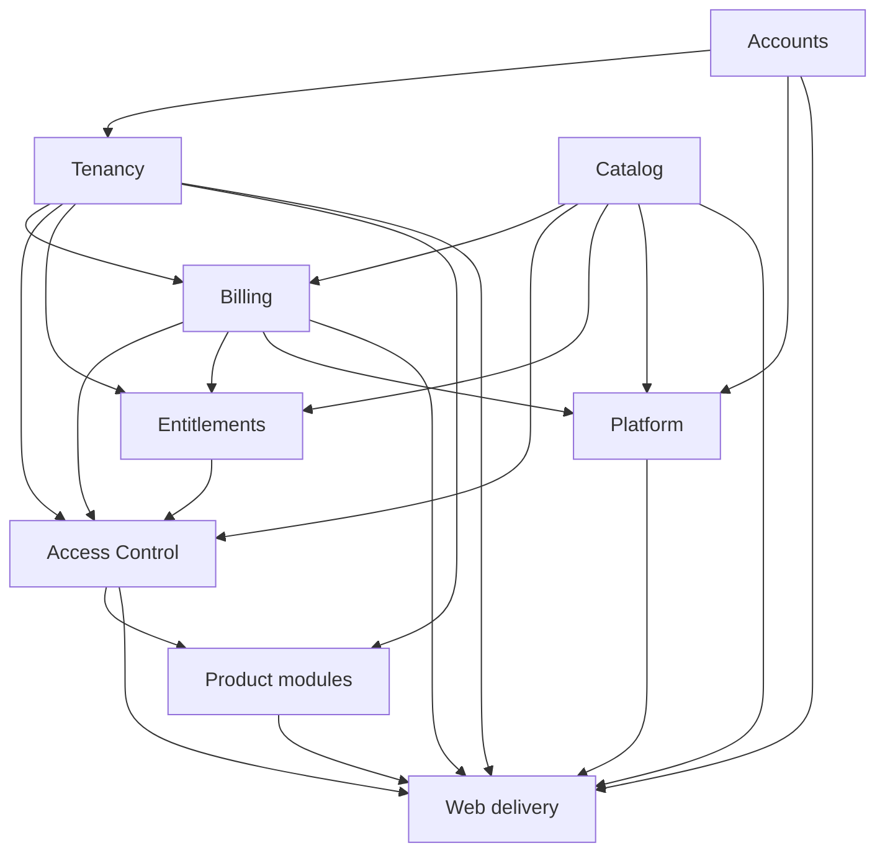

# Architecture: Rails Modular Monolith

Status: In progress
Last updated: 2026-07-16

## 1. Context

The target system is a production SaaS platform on Rails 8.1, PostgreSQL,
Hotwire, Tailwind, Pundit, Solid Queue, and Minitest. It is deployed as one
codebase and one application release, with separate web and worker processes.

The repository contains the Rails application foundation, PostgreSQL-backed CI,
email/password authentication, organization onboarding, locator-backed path
tenancy, audited organization invitations/member administration, and the
constrained local product/plan catalog. It also contains a non-authoritative
Billing persistence foundation, a fixed-origin Lemon API client, the local
Entitlements read side, product-RBAC persistence with transactional assignment
commands, and the central runtime Access/Pundit composition. This document also
covers the implemented customer shell, audited product-assignment surface, and
the Analytics report/action/capacity vertical slice. Owner/billing checkout,
environment-qualified provider-price mapping, digest-only provider correlation,
and the local pending-return page are implemented. Signed webhook
ingress, durable receipt, and Solid Queue handoff are also implemented;
subscription projection, provider portal operations, broader product workflows,
and deployment hardening remain incremental milestones.

Related contracts:

- [Product Requirements](product_requirements.md)
- [Data Model](data_model.md)
- [Authorization Model](authorization_model.md)
- [Billing Model](billing_model.md)
- [Security Model](security_model.md)
- [ADR 0001: Modular Monolith](adr/0001-modular-monolith.md)
- [ADR 0002: Local Entitlements](adr/0002-local-entitlements.md)
- [ADR 0003: Path-Based Tenancy](adr/0003-path-based-tenancy.md)

## 2. Architectural principles

1. **One deployable, explicit modules.** Keep one Rails application and one
   transactional PostgreSQL boundary while organizing domain ownership and
   dependency direction explicitly.
2. **Tenant context is mandatory.** Tenant-owned data is queried through
   `Current.organization`; ambient `default_scope` tenancy is prohibited.
3. **Fail closed.** Missing tenant/authorization context and incomplete
   entitlement input deny access. Unknown billing state and mapping errors deny
   paid-plan selection; only the explicit active free-plan fallback remains.
4. **Local decisions.** Runtime authorization uses local database state only.
5. **Webhook authority.** Only verified webhook-rooted processing changes local
   subscription state; redirects and outbound API responses are informational.
6. **Defense in depth.** Pundit policies, tenant-rooted queries, and database
   constraints each enforce a different layer.
7. **Small changes.** Schema, services, policies, UI, and operations land in
   reviewable PRs with tests at each behavior boundary.
8. **No premature distribution.** Use ordinary Ruby calls and database
   transactions inside the monolith. Extract a service only after measured
   operational need and a stable module contract.

## 3. System context


The browser never receives an API credential. Lemon Squeezy calls are made only
from server-side billing adapters. Product authorization does not cross the
network boundary.

## 4. Module boundaries

| Module | Owns | May depend on | Must not own |
| --- | --- | --- | --- |
| Accounts | `User`, sessions, password reset | Rails security primitives | Organizations, plans, billing |
| Tenancy | `Organization`, memberships, `Organizations::*` commands, invitations, global access locators, `Current`, tenant loader | Accounts | Product permission logic, provider calls |
| Catalog | Products, features, stable-keyed plans, plan-product/feature entitlements, and local plan-price records | None of the tenant modules | Organization state, usage, subscription lifecycle |
| Billing | Customers, checkout attempts, subscriptions/history, plan-change commands, webhook ledger, environment-specific price mappings, checkout-token provider locators, checkout command, and Lemon adapter | Tenancy, Catalog | Product RBAC or product resource data |
| Entitlements | Paid-status policy, effective-plan selection, typed product/feature result, versioned catalog snapshot | Tenancy, Catalog, Billing | Product RBAC, provider HTTP, usage mutation |
| Access Control | Product memberships, roles, permissions, Pundit base integration, central common gate | Tenancy, Catalog, Billing, Entitlements | Provider HTTP, product-specific record/usage mutations |
| Product modules | Tenant product records, Pundit record rules, authoritative numeric usage/commands | Tenancy, Access Control | Subscription projection or global role definitions |
| Platform | Internal admin delivery/policies, `Platform::PersistCatalog`, platform and tenant audit/logging, jobs, mail, health, deployment and observability | Accounts, Catalog, bounded Billing reads, and other explicit module APIs | Business decisions hidden in callbacks |

Organization role checks belong to Tenancy. Billing owns persisted provider
state. Entitlements composes the local paid-status policy with Catalog to return
an effective paid/free plan and typed entitlement result, without RBAC. Access
Control composes that answer with product RBAC. Product modules add record and
capacity rules.

### 4.1 Dependency direction



The arrows mean "is used by." Product modules do not query billing tables
directly; they ask the Access Control gate. Entitlements does not grant product
permissions, and Billing does not grant permissions.

Access Control owns the constrained product membership, role, permission, and
assignment persistence, tenant-scoped transactional commands,
`Access::Gate`/`PermissionChecker`/`Decision`, and Pundit integration helpers.
The tenant product-membership controller applies `ProductMembershipPolicy`,
passes the authenticated actor into the transactional commands, and those
commands revalidate live owner/admin plus entitlement state and append audit
evidence. Actor-less compatibility calls remain internal-only and require a
separately authorized system boundary. System roles are global reviewed
definitions; the nullable organization scope is schema support for future
custom roles, not an MVP custom-role builder.

The `Products::Analytics` namespace is the reference product boundary. Its
action registry fixes permission, typed-feature, and capacity semantics in
server code; its Pundit policies add tenant-record rules, and `CreateReport`
owns the organization lock, authoritative report count, and mutation
transaction. It depends on Access rather than reading Billing projection state
directly.

The internal platform-admin web layer orchestrates Accounts authentication,
Catalog mutation commands, and bounded Billing reads. It does not move catalog
rules into controllers and does not reuse tenant controllers for cross-tenant
access. `User.system_role` is re-read from PostgreSQL for every admin request;
organization roles do not participate in that decision.

## 5. Code organization

Keep conventional top-level Active Record aggregate names where they improve
Rails clarity (`User`, `Organization`, `Plan`, `ProductMembership`). Namespace
orchestration and provider-specific code by owning module.

Implemented and planned layout (checkout mapping/locator/command plus webhook
receipt/handoff are present; subscription projection, portal, and broader
product modules remain planned):

```text
app/
  controllers/
    admin/...
    concerns/tenant_context.rb
    organizations/...
    organizations/billing_checkouts_controller.rb
    billing/...
    webhooks/lemon_squeezy_controller.rb
  jobs/
    billing/process_webhook_job.rb
    billing/sweep_webhook_events_job.rb
  models/
    current.rb
    user.rb
    organization.rb
    organization_membership.rb
    organization_access_locator.rb
    organization_invitation.rb
    product.rb
    product_feature.rb
    plan.rb
    plan_product.rb
    plan_feature_entitlement.rb
    plan_price.rb
    product_membership.rb
    product_membership_role.rb
    product_role.rb
    product_permission.rb
    product_role_permission.rb
    analytics_report.rb
    audit_event.rb
    platform/audit_event.rb
    billing/customer.rb
    billing/provider_price_mapping.rb
    billing/checkout_attempt.rb
    billing/subscription.rb
    billing/plan_change.rb
    billing/provider_locator.rb
    billing/webhook_event.rb
  policies/
    admin/...
    application_policy.rb
    product_membership_policy.rb
    products/analytics/...
  services/
    platform/persist_catalog.rb
    organizations/
      create.rb
      memberships/change_role.rb
      memberships/remove.rb
    tenancy/...
    catalog/...
    entitlements/
      resolver.rb
      result.rb
      subscription_access_policy.rb
    access/
      decision.rb
      gate.rb
      permission_checker.rb
      product_memberships/add.rb
      product_memberships/remove.rb
      product_memberships/assign_role.rb
      product_memberships/suspend.rb
      product_memberships/reactivate.rb
      product_memberships/unassign_role.rb
      seed_system_product_rbac.rb
    products/analytics/
      action_registry.rb
      create_report.rb
      csv_exporter.rb
    billing/...
      checkouts/create.rb
      checkouts/return_url.rb
      checkouts/token.rb
      provider_price_mappings/configure.rb
      lemon_squeezy/client.rb
      lemon_squeezy/errors.rb
  views/
test/
  fixtures/
  models/
  policies/
  requests/
  jobs/
  services/
  system/
```

Do not introduce Rails engines, internal gems, a generic event bus, or Packwerk
in the MVP. A lightweight architecture test maintains an explicit allowed
module dependency map and rejects forbidden constant/file references; focused
contract tests and code review supplement it. Add heavier tooling later only if
violations become recurrent.

## 6. Request architecture

### 6.1 Global requests

Authentication, password reset, verified-and-authenticated onboarding at
`POST /organizations`, the internal `/admin` namespace, the root landing page,
`/up`, readiness, and `POST /webhooks/lemon_squeezy` are outside ordinary tenant
routes. Global application controllers still authenticate and authorize where
appropriate. The webhook action is the narrow exception: it inherits directly
from `ActionController::Metal`, reads no Rails parameters/session/tenant state,
and delegates exact-body signature verification and durable receipt to Billing.
This prevents normal controller instrumentation from parsing JSON before HMAC
verification. `Organizations::Create`, which is owned by the Tenancy module
despite its public namespace, atomically inserts the active organization and
first active owner membership. It sets
`Current.organization` and `Current.membership` only after the
outermost transaction commits, so rollback cannot leave request-local context
pointing at uncommitted records. Registration and email verification never
create an organization automatically.

The path-bootstrap migration adds and backfills the non-authoritative access
locator before enabling `/o/:organization_slug/` routes. Successful onboarding
therefore creates its locator atomically and redirects to the tenant dashboard.
The account-disable mutation remains unexposed until its cross-organization
ownership guard can enumerate locator candidates and check every tenant's
access-eligible-owner state through `Current.organization` under stable-order
locks.

### 6.2 Internal admin requests

Every controller in the `/admin` namespace inherits one authenticated base
controller and authorizes the live PostgreSQL `platform_admin` role before
loading or rendering a resource. A stale in-memory role, organization owner
membership, and navigation visibility are never authorization evidence. Catalog
records are global system records, but writes go through the Platform-owned
Catalog persistence command that preserves immutable identities and lifecycle
rules and records global audit evidence. A new plan-product requires an active
plan and product, a new plan-price requires an active plan, and a new feature
entitlement requires its plan, product, and feature to be active. Deactivation
retains every existing relationship and billing-history reference.

Subscription diagnostics deliberately do not perform an unscoped cross-tenant
child query. The administrator submits one exact organization `public_id`; the
application does not load a global organization dropdown. The request sets
`Current.organization` to that explicit root, and subscriptions are then read
through `Current.organization.billing_subscriptions` in pages of at most 100.
The diagnostic surface is read-only and does not establish an organization
membership or grant tenant/product authority. Failed webhook events are
different: they belong to the global provider-ingress ledger and may be read
through its restricted admin policy, also in pages of at most 100, without
pretending that an unresolved event has a tenant.

### 6.3 Tenant requests

All organization application routes are nested under:

```ruby
scope "/o/:organization_slug", as: :organization do
  # dashboard, products/product members, pricing, billing, settings
  # analytics dashboard and reports
end
```

The request lifecycle is:

1. Authenticate the user.
2. Normalize the slug and select a candidate organization through
   the authenticated user's global, non-authoritative access locator.
3. Require an active organization, set `Current.organization`, then reload the
   active membership through
   `Current.organization.organization_memberships` and set
   `Current.membership`.
4. Load tenant records from a `Current.organization` association and a Pundit
   policy scope.
5. Authorize the record/action on the server.
6. Reset all `Current` attributes in an `ensure` block.

A slug alone is never sufficient. Non-members receive not-found behavior, and
record identifiers from another tenant cannot escape the tenant-rooted query.
The invitation-acceptance route is a special pre-membership flow: it sets a
tentative organization root from the public slug and may query only that
organization's invitation association until token/email validation succeeds.
The customer pricing page reads only active global catalog rows; the tenant
billing page reads the current subscription only through
`Current.organization.billing_subscriptions`. Both GET routes remain local-only.
Pricing may render a separate server-authorized checkout POST for an active
owner/billing member and an exact eligible environment/store mapping. Checkout
creates a tenant attempt and locator, calls Lemon once, and returns to the
canonical tenant pending page; neither API success nor browser navigation writes
subscription/access state.

### 6.4 Background jobs

Every tenant job accepts an immutable `organization_id`, loads only that tenant
root, establishes context through a dedicated job wrapper, reloads all tenant
children from `Current.organization`, and clears context in `ensure`. A missing
organization fails closed. Serialized Active Record tenant objects are avoided
when an ID plus explicit reload is safer.

A global scheduler may enumerate only organization roots (or genuinely global
ledger/locator rows) to enqueue per-organization work. It never sweeps a
tenant-owned child table globally.

The verified webhook resolver may query only the global
`Billing::ProviderLocator` after signature and envelope validation. The current
locator supports checkout-token digest discovery; provider subscription-ID
lookup remains an additive projection milestone. A locator selects only a
candidate organization; all tenant reads/writes are reloaded through
`Current.organization`.

## 7. Authorization architecture

Pundit is the controller/policy integration layer, not the full decision model.
The central read-only `Access::Gate` returns an immutable `Access::Decision` and
composes:

```text
active organization
AND active organization membership
AND effective local plan (accessible paid subscription or active free fallback)
AND plan product entitlement
AND optional enabled flag or finite/unlimited feature entitlement
AND active product membership
AND organization role is not billing
AND permission from an active system or same-organization product role
```

`Entitlements::Resolver` evaluates the time-sensitive paid-status policy on
every resolver construction. It caches only a primitive catalog snapshot for 12
hours, keyed by `cache_key_with_version` for the effective plan, candidate
subscription, products, features, plan products, and entitlement rows. No Active
Record objects, RBAC result, or cancellation/grace decision is cached. Versioned
keys invalidate catalog changes and old key generations expire naturally.

`ApplicationPolicy` and its base scope expose protected helpers that invoke this
same gate; product policies then apply tenant record rules. A consuming product
command revalidates the common grant and atomically enforces product-owned usage
plus its server-calculated delta against returned finite capacity in the same
transaction as mutation; explicit unlimited capacity still follows the command
and permission path but has no numeric ceiling. Action-to-permission, feature,
and consumption mappings are server-owned, so a client cannot omit a capacity
check.

For Analytics, `ActionRegistry` evaluates `dashboard_read`, `report_read`,
`report_create`, `report_manage`, and `export_run` through the common gate.
`AnalyticsReport` show/export loaders begin at
`Current.organization.analytics_reports` and use an immutable public UUID.
`CreateReport` repeats the `report_create` decision while holding the tenant
root lock, treats one new report as a server-calculated delta of one, compares
the tenant-scoped count to finite or explicit unlimited `report_limit`, and
persists only if the same transaction still has capacity.

Organization administration and billing actions use the explicit organization
role matrix and do not require a product subscription. Product actions always
use the complete product gate. See
[Authorization Model](authorization_model.md).

Controllers enable `verify_authorized` and `verify_policy_scoped` with a small,
reviewed allowlist for endpoints such as health checks. UI predicates can hide
controls but never replace request authorization.

## 8. Data and transaction architecture

- PostgreSQL is the system of record for users, tenants, catalog, RBAC,
  subscription projections, and authorization state.
- Tenant-owned tables carry a non-null `organization_id`, even when derivable,
  so query ownership and composite foreign keys are explicit.
- Global catalog tables never carry `organization_id` in the MVP. Global locator
  infrastructure may carry `organization_id` solely to establish a candidate
  root; it contains no authorization grant and is revalidated through tenant
  associations.
- Required relationships use foreign keys; business identities use unique
  indexes; enums/types/ranges use database check constraints.
- Cross-tenant and cross-product joins use composite foreign keys, not only
  model validation.
- Catalog identities use stable keys and explicit active flags. Catalog writes
  use the platform-admin-only transactional command and append-only global audit
  ledger; destructive graph repair remains deployment-controlled. An active/
  free/price flag never creates a persisted organization-plan assignment or
  changes subscription state; `active AND free` may select only the documented
  runtime fallback.
- `PlanPrice` is catalog/display data and a Billing input, not an access grant.
  Checkout requires an immutable exact `Billing::ProviderPriceMapping` for the
  configured test/live environment and store. The mapping and attempt remain
  non-authoritative; future verified webhook projection is the only path that
  may change a subscription.
- Service objects own multi-row state transitions. Authorization-sensitive
  invariants do not depend on uncontrolled Active Record callbacks.
- `Organizations::Memberships::ChangeRole`,
  `Organizations::Memberships::Remove`, and
  `Organizations::Memberships::Reactivate` are the Tenancy-owned, locked
  command boundaries for role changes, soft suspension, and reactivation;
  billing and member actors cannot invoke a successful
  membership-management transition.
- A webhook projection, subscription update, and event completion marker commit
  atomically under row locks.
- Numeric consuming operations lock or conditionally update authoritative usage
  in the same transaction as the product mutation.

The exact schema contract is in [Data Model](data_model.md).

## 9. Asynchronous architecture

Solid Queue handles webhook projection, receipt sweeping, mail delivery, and
operational reconciliation. The webhook HTTP endpoint performs bounded
verification and durable receipt, then acknowledges quickly. Business
processing occurs asynchronously.

The current ingress milestone enqueues only the global event ID and records
`enqueued_at`. Its handoff job intentionally leaves the event in `received` and
cannot mutate a subscription. The periodic sweeper retries receipts whose
initial enqueue failed and redispatches still-`received` handoffs after six
hours, so receipts accepted before the processor release are not stranded. A
later projection worker will claim the verified row idempotently, establish
tenant context after provider-locator resolution, and own all subscription
mutation.

Job rules:

- Enqueue only after the receipt transaction commits.
- Make every job idempotent and safe to retry.
- Use exponential backoff with jitter for network/429/5xx failures.
- Quarantine permanent provider mapping or validation failures and alert.
- Re-enqueue stale `received`/`processing` webhook rows with a periodic sweeper.
- A reconciliation job may detect and report drift, but it cannot independently
  mutate local subscription state. Repair is rooted in a verified webhook
  resend or reprocessing of a previously verified event.

## 10. Provider integration boundary

`Billing::LemonSqueezy::Client` is the only outbound API adapter. It owns fixed
base URLs, authentication headers, timeouts, response validation, rate-limit
handling, and redacted errors. Callers pass local identifiers, not arbitrary
URLs or provider request fragments. The initial adapter performs one request
per call and does not install generic retry middleware. A later command/job may
retry an idempotent read according to its state machine; non-idempotent `POST`
operations are never blindly retried.

`Billing::Checkouts::Create` is the current web-facing caller. Under tenant and
organization locks it revalidates the owner/billing actor, paid price/plan,
exact active mapping, one-pending-attempt invariant, and absence of a
non-expired current subscription. It commits a tenant attempt plus global
digest locator before making exactly one provider POST. The outbound signed
`MessageVerifier` token contains organization public ID, price ID, user ID,
nonce, and expiry; only the nonce digest is persisted. The return URL is the
canonical tenant pending route, and the checkout URL must use the configured
HTTPS host.

Valid response data may move only the attempt to `ready`. Local request or
configuration failures and provider statuses `400`, `401`, `403`, `404`, and
`422` become `failed`; timeout, connection, `408`, `429`, other
non-allowlisted responses, 5xx, malformed JSON, and invalid-success responses
become `creation_unknown`. The signed URL is redirected without persistence or
framework logging. None of these outcomes mutates local subscription state or
grants access. WebMock disables non-local network access in the test
environment, and adapter examples stub every provider response.

`Billing::LemonSqueezy::WebhookVerifier` consumes exact raw request bytes and a
versioned credential, verifies HMAC-SHA256 in constant time, and returns a
validated envelope. It is a planned component: parsing and tenant resolution
will happen only after verification when signed ingress is implemented.

Provider DTOs are mapped into local models. JSON:API payload structure does not
leak into product modules or Pundit policies.

## 11. Delivery architecture

- HTML is server-rendered by Rails.
- Turbo Frames/Streams update organization, assignment, and billing-pending
  views without duplicating authorization logic in JavaScript.
- Stimulus is reserved for small interaction behavior.
- Tailwind builds at image build time.
- Forms use Rails CSRF protection. Only the signed webhook endpoint has a
  narrowly scoped CSRF exemption.
- Product and organization IDs in forms are still treated as untrusted input
  and re-resolved through tenant scope.

## 12. Production topology

Minimum production topology:

- One or more stateless Rails web containers behind an HTTPS reverse proxy.
- At least one separate Solid Queue worker container.
- Managed/external PostgreSQL with primary, cache, queue, and cable databases
  as configured by Rails, or an explicitly documented consolidation decision.
- Durable automated database backups with a tested restore path.
- No dependency on container-local files for customer data.

Kamal must inject credentials through its secret mechanism or the deployment
environment. Required values include Rails master key, database URLs/passwords,
Lemon Squeezy API keys, test/live store identifiers, test/live webhook secrets,
application host, and mail credentials. Values and real endpoints are never
committed.

Before production, replace placeholder server/registry configuration, enable
`assume_ssl`, `force_ssl`, allowed hosts, and secure domain URL options, and wire
the dedicated job role. The production image runs as the existing non-root
user.

## 13. Observability and operations

Structured logs include request/job IDs and, after safe resolution, organization
ID. They exclude credentials, signatures, raw webhook bodies, checkout URLs,
portal URLs, email addresses, and provider payload PII.

Required signals:

- webhook receipts, duplicates, processing latency, retries, quarantine count,
  and oldest unprocessed event age;
- subscription mapping/status changes and fail-closed conflicts;
- Solid Queue depth, failed jobs, and worker heartbeat;
- HTTP error/latency rates and database pool saturation;
- backup success and last verified restore.

`/up` remains a liveness check. A separate authenticated or network-restricted
readiness check verifies required database connectivity without leaking
configuration.

## 14. Test architecture

Minitest is enabled before domain work. Test layers are:

- database/model tests for UUID identities, constraints, normalization, and
  active/suspended lifecycle rules;
- policy and service truth tables for organization roles and product access;
- request tests for authentication, tenant routing, IDOR, CSRF, and direct POST
  authorization;
- job tests for tenant context, retries, duplicates, and state projection;
- provider contract tests using sanitized official-style fixtures;
- concurrency tests for last-owner and finite-limit races;
- system tests for critical organization, assignment, checkout-pending, and
  subscription UI flows;
- production smoke checks for database preparation, eager load, image build,
  web boot, worker boot, and rollback compatibility.

CI runs PostgreSQL-backed tests and quality/security checks on every PR. See the
[Production MVP Execution Plan](exec_plans/production_mvp.md) for ordering and
commands.

## 15. Evolution rules

- A new module documents its owned data, public service API, and allowed
  dependencies before implementation.
- Cross-module writes go through the owning service; direct table mutation from
  another module is prohibited.
- Breaking catalog key changes require a migration/data transition, never an
  in-place rename without compatibility.
- Authorization contract changes update product requirements, authorization
  documentation, billing status policy when relevant, and the central truth
  table in one PR.
- Service extraction is considered only after a measurable scaling or ownership
  requirement; local entitlement data remains required even if Billing is later
  extracted.
