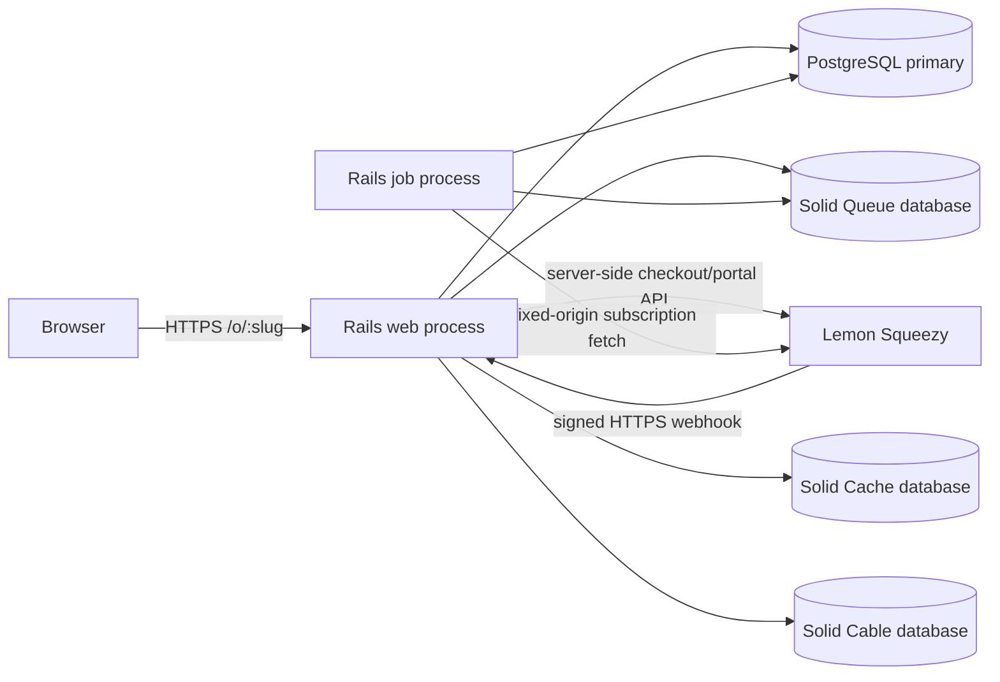
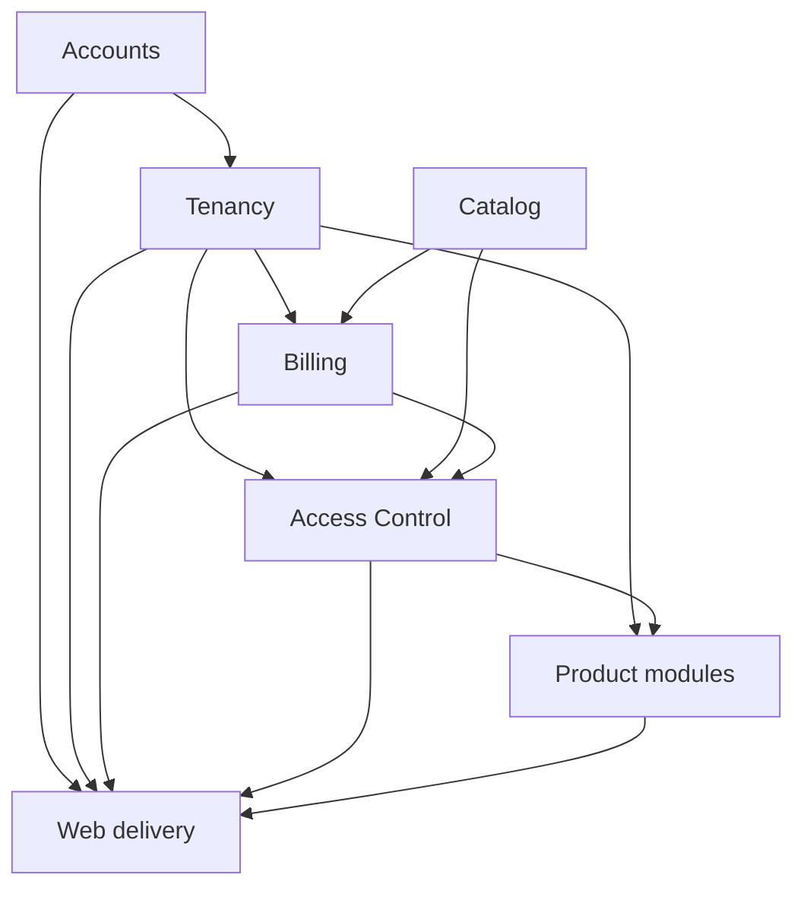

# Architecture: Rails Modular Monolith

Status: In progress
Last updated: 2026-07-16

## 1. Context

The target system is a production SaaS platform on Rails 8.1, PostgreSQL,
Hotwire, Tailwind, Pundit, Solid Queue, and Minitest. It is deployed as one
codebase and one application release, with separate web and worker processes.

The repository contains the Rails application foundation, PostgreSQL-backed CI,
email/password authentication, organization onboarding, locator-backed path
tenancy, and audited organization invitations/member administration. This
document describes both those established boundaries and the remaining target
architecture; catalog, product access, billing, and deployment hardening remain
incremental milestones.

Related contracts:

- [Product Requirements](product_requirements.md)
- [Data Model](data_model.md)
- [Authorization Model](authorization_model.md)
- [Billing Model](billing_model.md)
- [Security Model](security_model.md)
- [ADR 0001: Modular Monolith](adr/0001-modular-monolith.md)
- [ADR 0002: Local Entitlements](adr/0002-local-entitlements.md)
- [ADR 0003: Path-Based Tenancy](adr/0003-path-based-tenancy.md)

## 2. Architectural principles

1. **One deployable, explicit modules.** Keep one Rails application and one
   transactional PostgreSQL boundary while organizing domain ownership and
   dependency direction explicitly.
2. **Tenant context is mandatory.** Tenant-owned data is queried through
   `Current.organization`; ambient `default_scope` tenancy is prohibited.
3. **Fail closed.** Missing context, unknown billing state, mapping errors, and
   incomplete authorization input deny access.
4. **Local decisions.** Runtime authorization uses local database state only.
5. **Webhook authority.** Only verified webhook-rooted processing changes local
   subscription state; redirects and outbound API responses are informational.
6. **Defense in depth.** Pundit policies, tenant-rooted queries, and database
   constraints each enforce a different layer.
7. **Small changes.** Schema, services, policies, UI, and operations land in
   reviewable PRs with tests at each behavior boundary.
8. **No premature distribution.** Use ordinary Ruby calls and database
   transactions inside the monolith. Extract a service only after measured
   operational need and a stable module contract.

## 3. System context



The browser never receives an API credential. Lemon Squeezy calls are made only
from server-side billing adapters. Product authorization does not cross the
network boundary.

## 4. Module boundaries

| Module | Owns | May depend on | Must not own |
| --- | --- | --- | --- |
| Accounts | `User`, sessions, password reset | Rails security primitives | Organizations, plans, billing |
| Tenancy | `Organization`, memberships, `Organizations::*` commands, invitations, global access locators, `Current`, tenant loader | Accounts | Product permission logic, provider calls |
| Catalog | Products, features, immutable plan versions and entitlements | None of the tenant modules | Organization state, usage, billing lifecycle |
| Billing | Prices, checkout attempts, subscriptions, global provider locators, webhook ledger, Lemon adapter | Tenancy, Catalog | Product RBAC or product resource data |
| Access Control | Product memberships, roles, permissions, Pundit base integration, central common gate | Tenancy, Catalog, Billing | Provider HTTP, product-specific record/usage mutations |
| Product modules | Tenant product records, Pundit record rules, authoritative numeric usage/commands | Tenancy, Access Control | Subscription projection or global role definitions |
| Platform | Jobs, mail, audit/logging, health, deployment and observability | Explicit module APIs | Business decisions hidden in callbacks |

Organization role checks belong to Tenancy. Subscription eligibility belongs to
Billing. Catalog entitlement lookup belongs to Catalog. Access Control composes
those answers with product RBAC. Product modules add record and capacity rules.

### 4.1 Dependency direction



The arrows mean "is used by." Product modules do not query billing tables
directly; they ask the Access Control gate. Billing does not grant permissions.

## 5. Code organization

Keep conventional top-level Active Record aggregate names where they improve
Rails clarity (`User`, `Organization`, `Plan`, `ProductMembership`). Namespace
orchestration and provider-specific code by owning module.

Proposed layout:

```text
app/
  controllers/
    concerns/tenant_context.rb
    organizations/...
    billing/...
    webhooks/lemon_squeezy_controller.rb
  jobs/
    billing/process_webhook_job.rb
    billing/sweep_webhook_events_job.rb
  models/
    current.rb
    user.rb
    organization.rb
    organization_membership.rb
    organization_access_locator.rb
    organization_invitation.rb
    product.rb
    product_feature.rb
    plan.rb
    plan_product_entitlement.rb
    plan_feature_entitlement.rb
    product_membership.rb
    product_membership_role.rb
    product_role.rb
    product_permission.rb
    product_role_permission.rb
    audit_event.rb
    billing/price.rb
    billing/checkout_attempt.rb
    billing/subscription.rb
    billing/provider_locator.rb
    billing/webhook_event.rb
  policies/
  services/
    organizations/
      create.rb
      memberships/change_role.rb
      memberships/remove.rb
    tenancy/...
    catalog/...
    access/decision.rb
    billing/...
  views/
test/
  fixtures/
  models/
  policies/
  requests/
  jobs/
  services/
  system/
```

Do not introduce Rails engines, internal gems, a generic event bus, or Packwerk
in the MVP. A lightweight architecture test maintains an explicit allowed
module dependency map and rejects forbidden constant/file references; focused
contract tests and code review supplement it. Add heavier tooling later only if
violations become recurrent.

## 6. Request architecture

### 6.1 Global requests

Authentication, password reset, verified-and-authenticated onboarding at
`POST /organizations`, the root
landing page, `/up`, readiness, and `POST /webhooks/lemon_squeezy` are outside
ordinary tenant routes. Global application controllers still authenticate and
authorize where appropriate. `Organizations::Create`, which is owned by the
Tenancy module despite its public namespace, atomically inserts the active
organization and first active owner membership. It sets
`Current.organization` and `Current.membership` only after the
outermost transaction commits, so rollback cannot leave request-local context
pointing at uncommitted records. Registration and email verification never
create an organization automatically.

The path-bootstrap migration adds and backfills the non-authoritative access
locator before enabling `/o/:organization_slug/` routes. Successful onboarding
therefore creates its locator atomically and redirects to the tenant dashboard.
The account-disable mutation remains unexposed until its cross-organization
ownership guard can enumerate locator candidates and check every tenant's
access-eligible-owner state through `Current.organization` under stable-order
locks.

### 6.2 Tenant requests

All organization application routes are nested under:

```ruby
scope "/o/:organization_slug", as: :organization do
  # tenant routes
end
```

The request lifecycle is:

1. Authenticate the user.
2. Normalize the slug and select a candidate organization through
   the authenticated user's global, non-authoritative access locator.
3. Require an active organization, set `Current.organization`, then reload the
   active membership through
   `Current.organization.organization_memberships` and set
   `Current.membership`.
4. Load tenant records from a `Current.organization` association and a Pundit
   policy scope.
5. Authorize the record/action on the server.
6. Reset all `Current` attributes in an `ensure` block.

A slug alone is never sufficient. Non-members receive not-found behavior, and
record identifiers from another tenant cannot escape the tenant-rooted query.
The invitation-acceptance route is a special pre-membership flow: it sets a
tentative organization root from the public slug and may query only that
organization's invitation association until token/email validation succeeds.

### 6.3 Background jobs

Every tenant job accepts an immutable `organization_id`, loads only that tenant
root, establishes context through a dedicated job wrapper, reloads all tenant
children from `Current.organization`, and clears context in `ensure`. A missing
organization fails closed. Serialized Active Record tenant objects are avoided
when an ID plus explicit reload is safer.

A global scheduler may enumerate only organization roots (or genuinely global
ledger/locator rows) to enqueue per-organization work. It never sweeps a
tenant-owned child table globally.

The verified webhook resolver may query only the global
`Billing::ProviderLocator` after signature and envelope validation, using a
provider subscription identifier or checkout-token digest. The locator selects
a candidate organization; all tenant reads/writes are reloaded through
`Current.organization`.

## 7. Authorization architecture

Pundit is the controller/policy integration layer, not the full decision model.
A central, pure `Access::Decision` composes:

```text
active organization
AND active organization membership
AND locally access-granting synchronized subscription
AND plan product entitlement
AND optional typed feature entitlement/limit
AND product membership
AND product-role permission
```

The product Pundit policy then applies tenant record rules. A consuming product
command revalidates the common grant and atomically enforces product-owned usage
plus its server-calculated delta against the returned numeric limit in the same
transaction as mutation. Action-to-permission/feature/consumption mappings are
server-owned, so a client cannot omit a capacity check.

Organization administration and billing actions use the explicit organization
role matrix and do not require a product subscription. Product actions always
use the complete product gate. See
[Authorization Model](authorization_model.md).

Controllers enable `verify_authorized` and `verify_policy_scoped` with a small,
reviewed allowlist for endpoints such as health checks. UI predicates can hide
controls but never replace request authorization.

## 8. Data and transaction architecture

- PostgreSQL is the system of record for users, tenants, catalog, RBAC,
  subscription projections, and authorization state.
- Tenant-owned tables carry a non-null `organization_id`, even when derivable,
  so query ownership and composite foreign keys are explicit.
- Global catalog tables never carry `organization_id` in the MVP. Global locator
  infrastructure may carry `organization_id` solely to establish a candidate
  root; it contains no authorization grant and is revalidated through tenant
  associations.
- Required relationships use foreign keys; business identities use unique
  indexes; enums/types/ranges use database check constraints.
- Cross-tenant and cross-product joins use composite foreign keys, not only
  model validation.
- Published plan versions and their entitlement graph are immutable.
- Service objects own multi-row state transitions. Authorization-sensitive
  invariants do not depend on uncontrolled Active Record callbacks.
- `Organizations::Memberships::ChangeRole`,
  `Organizations::Memberships::Remove`, and
  `Organizations::Memberships::Reactivate` are the Tenancy-owned, locked
  command boundaries for role changes, soft suspension, and reactivation;
  billing and member actors cannot invoke a successful
  membership-management transition.
- A webhook projection, subscription update, and event completion marker commit
  atomically under row locks.
- Numeric consuming operations lock or conditionally update authoritative usage
  in the same transaction as the product mutation.

The exact schema contract is in [Data Model](data_model.md).

## 9. Asynchronous architecture

Solid Queue handles webhook projection, receipt sweeping, mail delivery, and
operational reconciliation. The webhook HTTP endpoint performs bounded
verification and durable receipt, then acknowledges quickly. Business
processing occurs asynchronously.

Job rules:

- Enqueue only after the receipt transaction commits.
- Make every job idempotent and safe to retry.
- Use exponential backoff with jitter for network/429/5xx failures.
- Quarantine permanent provider mapping or validation failures and alert.
- Re-enqueue stale `received`/`processing` webhook rows with a periodic sweeper.
- A reconciliation job may detect and report drift, but it cannot independently
  mutate local subscription state. Repair is rooted in a verified webhook
  resend or reprocessing of a previously verified event.

## 10. Provider integration boundary

`Billing::LemonSqueezy::Client` is the only outbound API adapter. It owns fixed
base URLs, authentication headers, timeouts, response validation, rate-limit
handling, and redacted errors. Callers pass local identifiers, not arbitrary
URLs or provider request fragments.

`Billing::LemonSqueezy::WebhookVerifier` consumes exact raw request bytes and a
versioned credential, verifies HMAC-SHA256 in constant time, and returns a
validated envelope. Parsing and tenant resolution happen only after
verification.

Provider DTOs are mapped into local models. JSON:API payload structure does not
leak into product modules or Pundit policies.

## 11. Delivery architecture

- HTML is server-rendered by Rails.
- Turbo Frames/Streams update organization, assignment, and billing-pending
  views without duplicating authorization logic in JavaScript.
- Stimulus is reserved for small interaction behavior.
- Tailwind builds at image build time.
- Forms use Rails CSRF protection. Only the signed webhook endpoint has a
  narrowly scoped CSRF exemption.
- Product and organization IDs in forms are still treated as untrusted input
  and re-resolved through tenant scope.

## 12. Production topology

Minimum production topology:

- One or more stateless Rails web containers behind an HTTPS reverse proxy.
- At least one separate Solid Queue worker container.
- Managed/external PostgreSQL with primary, cache, queue, and cable databases
  as configured by Rails, or an explicitly documented consolidation decision.
- Durable automated database backups with a tested restore path.
- No dependency on container-local files for customer data.

Kamal must inject credentials through its secret mechanism or the deployment
environment. Required values include Rails master key, database URLs/passwords,
Lemon Squeezy API keys, test/live store identifiers, test/live webhook secrets,
application host, and mail credentials. Values and real endpoints are never
committed.

Before production, replace placeholder server/registry configuration, enable
`assume_ssl`, `force_ssl`, allowed hosts, and secure domain URL options, and wire
the dedicated job role. The production image runs as the existing non-root
user.

## 13. Observability and operations

Structured logs include request/job IDs and, after safe resolution, organization
ID. They exclude credentials, signatures, raw webhook bodies, checkout URLs,
portal URLs, email addresses, and provider payload PII.

Required signals:

- webhook receipts, duplicates, processing latency, retries, quarantine count,
  and oldest unprocessed event age;
- subscription mapping/status changes and fail-closed conflicts;
- Solid Queue depth, failed jobs, and worker heartbeat;
- HTTP error/latency rates and database pool saturation;
- backup success and last verified restore.

`/up` remains a liveness check. A separate authenticated or network-restricted
readiness check verifies required database connectivity without leaking
configuration.

## 14. Test architecture

Minitest is enabled before domain work. Test layers are:

- database/model tests for UUID identities, constraints, normalization, and
  active/suspended lifecycle rules;
- policy and service truth tables for organization roles and product access;
- request tests for authentication, tenant routing, IDOR, CSRF, and direct POST
  authorization;
- job tests for tenant context, retries, duplicates, and state projection;
- provider contract tests using sanitized official-style fixtures;
- concurrency tests for last-owner and numeric-limit races;
- system tests for critical organization, assignment, checkout-pending, and
  subscription UI flows;
- production smoke checks for database preparation, eager load, image build,
  web boot, worker boot, and rollback compatibility.

CI runs PostgreSQL-backed tests and quality/security checks on every PR. See the
[Production MVP Execution Plan](exec_plans/production_mvp.md) for ordering and
commands.

## 15. Evolution rules

- A new module documents its owned data, public service API, and allowed
  dependencies before implementation.
- Cross-module writes go through the owning service; direct table mutation from
  another module is prohibited.
- Breaking catalog key changes require a migration/data transition, never an
  in-place rename without compatibility.
- Authorization contract changes update product requirements, authorization
  documentation, billing status policy when relevant, and the central truth
  table in one PR.
- Service extraction is considered only after a measurable scaling or ownership
  requirement; local entitlement data remains required even if Billing is later
  extracted.
