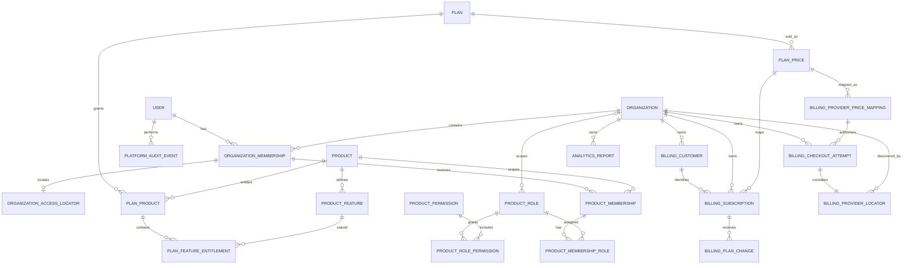

# Data Model

Status: Proposed
Last updated: 2026-07-16

## 1. Purpose

This document is the canonical relational model for the production MVP. It
defines ownership, names, relationships, indexes, foreign keys, and database
constraints. Account/session, organization, invitation/audit, and local catalog
migrations exist. A constrained Billing persistence foundation, read-only
Entitlements resolver, product-RBAC persistence/services, and the central
Access/Pundit decision layer also exist. The first product-owned table,
`analytics_reports`, and its policy/action/capacity slice are implemented;
the environment-qualified provider-price mapping, checkout-token locator, and
checkout attempt creation path are also implemented. Verified webhook
projection, subscription locators, and broader product modules remain planned
in the documented execution order.

Behavioral interpretation is defined in
[Authorization Model](authorization_model.md) and
[Billing Model](billing_model.md).

## 2. Conventions

- PostgreSQL is authoritative. All required associations have foreign keys and
  supporting indexes.
- Rails bigint primary keys are used for internal records. Public security
  tokens use UUIDs, high-entropy random tokens, or purpose-scoped Rails signed
  tokens whose expiry and invalidating state are explicit.
- Every table has non-null `created_at` and `updated_at` unless explicitly an
  append-only ledger with a more specific timestamp.
- Required strings are `NOT NULL` and protected by a non-blank `btrim` check.
- Enumerated strings have database check constraints. Application enums mirror,
  but do not replace, those constraints.
- Time is stored in UTC. Boundary checks use an injected `now` in application
  services so tests are deterministic.
- Foreign-key delete behavior defaults to `RESTRICT`/`NO ACTION`. The only MVP
  cascades are ephemeral sessions and pure child/join rows explicitly listed in
  section 11. Security and billing history never cascades from an ordinary UI
  operation.
- Every tenant-owned table contains a non-null `organization_id`, even when it
  can be derived through another relationship.
- Composite foreign keys prevent cross-organization and cross-product joins.
- Product, feature, role, and plan keys use lowercase ASCII snake case and are
  stable identities that are not renamed in place. Permission keys use dot-separated lowercase
  snake-case segments, for example `projects.create`.

## 3. Ownership classes

| Ownership | Tables | Query rule |
| --- | --- | --- |
| Global account | `users`, `sessions` | Through authenticated account/session |
| Tenant-owned | organizations' memberships, invitations, product assignments, organization-specific product roles, billing customers, checkout attempts, subscriptions, plan changes, product-domain records | Through `Current.organization` after bootstrap |
| Global system catalog | products, features, plans, plan products, feature entitlements, plan prices, system product roles, and product permissions | Read through explicit catalog/Access services; platform-admin writes use audited Catalog commands |
| Global billing integration catalog | `billing_provider_price_mappings` | Resolve through one exact local price/provider/environment allowlist; platform-admin writes use the audited mapping command |
| Global locator infrastructure | `organization_access_locators`, `billing_provider_locators` | Discovery only; never sufficient authorization; immediately reload tenant records through `Current.organization` |
| Provider ingress ledger | `billing_webhook_events` | No ordinary user query; verified system processing plus a restricted read-only platform-admin failure view |

`organizations` is the tenant root. Global locator rows may identify a candidate
tenant but never grant access. After setting the candidate root, every
tenant-owned child query, including the authoritative membership/subscription
check, is reloaded through `Current.organization`. The bootstraps are documented
in [Authorization Model](authorization_model.md#7-context-establishment-boundaries).
The read-only platform subscription diagnostic follows the same child-query
rule: a platform administrator supplies one exact organization `public_id`
without loading a global organization list, the request sets
`Current.organization`, and only then reads its subscription association in
pages of at most 100. The global webhook-event failure view is not treated as a
tenant child because unresolved provider-ingress rows may have no organization;
that view is independently limited to 100 rows per page.

## 4. Relationship overview

## 5. Accounts and tenancy

### 5.1 `User` / `users`

Planned columns:

- `name`: trimmed, non-blank text, not null.
- `email_address`: normalized lowercase text, not null.
- `password_digest`: not null.
- `email_verified_at`: nullable; non-null means the current normalized email
  address has been verified.
- `system_role`: `user` or `platform_admin`, not null, default `user`.
- `disabled_at`: nullable; non-null means the account cannot authenticate or
  authorize.

Constraints and indexes:

- unique functional index on `lower(email_address)`;
- checks that `name` is trimmed/non-blank and that the stored email is trimmed,
  lowercase, and non-blank;
- check that `system_role` is in the allowlist; the default role is `user` and
  public signup/update parameters never accept this field;
- unverified or disabled users cannot establish a new session or tenant
  context;
- disabling an account is allowed only through the locked ownership service
  described below.

Authentication secrets are one-way digests. Plain passwords are never stored.
Registration creates only the global account and sends verification; it does
not create an organization or tenant membership.

`system_role` is global account state, not an organization role. The internal
admin policy revalidates `platform_admin` from PostgreSQL on every request. The
first such role is assigned only by the explicit
`platform_admin:promote[email]` task after it locks and validates an existing,
verified, enabled user; organization ownership cannot substitute for promotion.

### 5.2 `Session` / `sessions`

- `user_id`: not-null foreign key to `users`, `ON DELETE CASCADE`; sessions are
  ephemeral, while any future user hard-deletion workflow remains separately
  authorized and audited.
- `token_digest`: not-null lowercase 64-character SHA-256 hex digest of an
  opaque high-entropy cookie token; globally unique. The raw token is persisted
  only in the browser cookie, handled transiently by the request, and never
  stored server-side or logged.
- `expires_at`: not null and set to 30 days after session creation.
- optional `ip_address`, `user_agent`, and `last_seen_at`, with bounded lengths.

Index `user_id`; add a unique index and lowercase-hex shape check for
`token_digest`, plus a check that `expires_at > created_at`. A login rotates
browser and server session state. Logout, password reset, account disablement,
and security-sensitive changes revoke applicable server-side sessions without
deleting business history.

Password reset and email verification do not add plaintext-token columns.
They use purpose-scoped Rails signed tokens bound to invalidating user state.
Password-reset tokens expire after 15 minutes and become invalid when the
password changes; email-verification tokens expire after 24 hours and become
invalid when the current email is verified or changed. Successful mutation is
therefore single-use. Token-bearing `GET` requests render confirmation only;
the state transition requires a CSRF-protected `PATCH`.

### 5.3 `Organization` / `organizations`

- `public_id`: UUID with a PostgreSQL `gen_random_uuid()` default for external
  references, not null.
- `name`: trimmed, non-blank text, at most 100 characters.
- `slug`: lowercase ASCII slug, immutable in the MVP.
- `status`: `active` or `suspended`, not null, default `active`.

Constraints and indexes:

- unique index on `public_id`;
- unique index on `slug`;
- slug check `^[a-z0-9]+(?:-[a-z0-9]+)*$` with length from 1 through 63;
- name trimmed/non-blank/maximum-length check;
- check that `status` is in the allowlist and an index on `status`.

An active organization may establish ordinary tenant context once path bootstrap
is enabled. A suspended organization authorizes no tenant access. Suspending an
organization and organization archive/hard deletion remain separate lifecycle
operations; neither is exposed by the initial tenant-foundation change.

There is no `owner_id` column. Ownership has one source:
`organization_memberships.role = 'owner'`.

For verified and authenticated onboarding, `Organizations::Create` inserts the
active organization and first active owner membership in one database
transaction after locking and validating the authoritative user row. It assigns
`Current.organization` and `Current.membership` only after the
outermost database transaction commits.
Registration and email verification do not invoke this command automatically.

### 5.4 `OrganizationMembership` / `organization_memberships`

- `organization_id`: not-null foreign key to `organizations`.
- `user_id`: not-null foreign key to `users`.
- `role`: `owner`, `admin`, `billing`, or `member`.
- `status`: `active` or `suspended`, not null, default `active`.
- `joined_at`: not-null timestamp recording the first successful join.

Constraints and indexes:

- unique `(organization_id, user_id)`;
- check allowed `role` and `status`;
- unique supporting tuples `(id, organization_id)` and
  `(id, user_id, organization_id)` for composite child/locator foreign keys;
- indexes on `user_id` and `(organization_id, status, role)`.
- a deferred PostgreSQL constraint trigger locks the organization root at commit
  and rejects organization creation, membership deletion, demotion, suspension,
  or reassignment when the committed state would contain no active owner.

The deferred trigger permits `Organizations::Create` to insert the organization
before its first owner inside one transaction while still enforcing the
cross-row invariant at commit. The primary database uses `db/structure.sql` so
fresh schema loads preserve the function and triggers.

`Organizations::Memberships::Remove` soft-suspends a membership rather than
deleting it, so actor history and billing-attempt relationships remain stable.
Once product assignments and the global access locator exist, suspension also
removes them atomically; reactivation never resurrects product assignments and
does not change `joined_at`. `Organizations::Memberships::ChangeRole` and
`Organizations::Memberships::Remove` resolve the target through
`Current.organization.organization_memberships`, lock the organization, and
prevent demoting or suspending the final **active** owner. Multiple active owners
are valid. A separate access-eligible owner is an active owner membership whose
user is not disabled. Before an account-disable mutation is exposed, its global
guard must enumerate only access-locator candidates, establish each
`Current.organization`, and lock roots in stable ID order before allowing a
disable transition that would leave no access-eligible owner.

### 5.5 `OrganizationAccessLocator` / `organization_access_locators`

A global, non-authoritative discovery index for authenticated organization
switching and path bootstrap. It was introduced after the initial organization
foundation; its migration backfills all existing active memberships and must
complete successfully before ordinary tenant paths are enabled.

- `organization_membership_id`, `user_id`, `organization_id`: not null.

Constraints and indexes:

- unique `organization_membership_id` and unique `(user_id, organization_id)`;
- composite foreign key
  `(organization_membership_id, user_id, organization_id)` to
  `organization_memberships(id, user_id, organization_id)`, delete restricted;
- indexes supporting `user_id` plus organization slug lookup.

The locator exists only for an active membership and is created/deleted in the
same locked transaction as membership activation/suspension. Account disable
leaves this non-authoritative discovery row in place so a cross-organization
ownership check and any future controlled recovery can find the same roots;
disabled-user authentication and the tenant membership reload still deny. It is
not authorization: a request uses it only to select a candidate organization,
sets
`Current.organization`, and reloads the active membership through
`Current.organization.organization_memberships`. A stale locator therefore
fails closed.

### 5.6 `OrganizationInvitation` / `organization_invitations`

- `organization_id`: not-null foreign key.
- `inviter_id`: not-null user foreign key. A composite tenant foreign key also
  proves that this user has an organization membership.
- `email_address`: normalized lowercase invite target.
- `organization_role`: invited organization role.
- `status`: `pending`, `accepted`, `revoked`, or `expired`.
- `token_digest`: one-way digest of a high-entropy token.
- `expires_at`, `accepted_at`, `revoked_at`.

Constraints and indexes:

- globally unique `token_digest`;
- partial unique index on `(organization_id, lower(email_address)) WHERE
  status = 'pending'`;
- composite foreign key
  `(organization_id, inviter_id)` to
  `organization_memberships(organization_id, user_id)`;
- role, status, and timestamp consistency checks.

Invitation acceptance locks the invitation, validates the authenticated email,
and creates or reactivates the unique organization membership atomically. The
create service first marks any elapsed pending invitation `expired` in the same
serialized workflow, because a partial-index predicate cannot depend on
`now()`. Invitations expire after seven days. Creating an invitation for an
email that already has an unexpired pending invitation returns that same row
without rotating or re-sending its token; the explicit resend command rotates
the digest and expiry. The invitation itself never authorizes tenant access.

## 6. Global catalog and plan entitlements

### 6.1 `Product` / `products`

- `key`: globally unique stable lowercase snake-case identifier.
- `name`: display name.
- `description`: normalized display description, defaulting to an empty string.
- `active`: non-null boolean, default true.

`key` is the application identity and is readonly after creation. `name` and
`description` are presentation values and are never lookup or authorization
inputs. Setting `active` false removes the product from new catalog selections;
it does not delete retained references and is not an emergency authorization
kill switch. The internal catalog UI deactivates a product and never hard-deletes
it.

### 6.2 `ProductFeature` / `product_features`

- `product_id`: not-null foreign key to `products`, delete restricted.
- `key`: stable within the product.
- `name`: display name.
- `description`: normalized display description, defaulting to an empty string.
- `kind`: `flag` or `limit`.
- `active`: non-null boolean, default true.

Constraints and indexes:

- unique `(product_id, key)`;
- check allowed `kind`;
- unique `(id, product_id, kind)` to support a composite entitlement
  foreign key.

A feature key is not a permission key. Entitlements maintains an explicit,
code-reviewed registry from each supported `(product_key, feature_key)` pair to
its unit, tenant-rooted authoritative usage query, and deterministic remediation
ordering. The registry is not database-driven constant lookup and it never
creates a generic usage ledger. `product_id`, `key`, and `kind` are readonly
identities. Setting `active` false blocks new catalog selection but does not
rewrite existing rows. The internal catalog UI uses that lifecycle transition
and never hard-deletes a feature.

### 6.3 `Plan` / `plans`

- `key`: globally unique stable identifier, such as `starter`.
- `name`: display name.
- `description`: normalized display description, defaulting to an empty string.
- `active`: non-null boolean, default true.
- `free`: non-null boolean, default false.
- `position`: non-negative integer used only for deterministic display order.

Constraints and indexes:

- unique `key`;
- partial unique index allowing at most one row where `active AND free`;
- non-negative `position` check.

`key` is readonly after creation. `free` identifies the system fallback class;
the one active free plan becomes effective when no current paid subscription is
accessible. It does not attach a plan ID to an organization, mutate a
subscription, or permit manual grants. An inactive plan is unavailable for new
plan-product, plan-price, feature-entitlement, and future checkout relationships,
but changing `active` does not remove existing catalog rows or change a local
paid subscription.
The internal catalog UI deactivates plans rather than deleting them. Changing
plan catalog state is an audited authorization-affecting operation and does not
rewrite subscription rows.

### 6.4 `PlanProduct` / `plan_products`

- `plan_id`: not-null foreign key to `plans`, delete restricted.
- `product_id`: not-null foreign key to `products`, delete restricted.

Presence grants base product entitlement when the effective plan (an accessible
paid subscription plan or the active free fallback) resolves to that plan. It
grants nothing by itself. Constraints:

- unique `(plan_id, product_id)`;
- supporting unique `(id, product_id)` for the feature-entitlement composite
  foreign key;
- supporting index on `product_id`.

Absence denies the product.

The internal admin surface may create this stable plan/product association once,
but only while both its plan and product are active. Deactivation retains every
existing `PlanProduct`; the UI does not repoint, update, or remove it, and
broader destructive catalog graph editing remains deployment-controlled.

### 6.5 `PlanFeatureEntitlement` / `plan_feature_entitlements`

- `plan_product_id`, `product_feature_id`: not-null restricted foreign keys.
- `product_id`: not-null integrity copy of the plan product's product.
- `feature_kind`: not-null integrity copy of the feature's `kind`.
- `enabled`: non-null master grant switch, default false.
- `limit_value`: nullable bigint.
- `unlimited`: non-null boolean, default false.
- `settings`: non-null JSONB object, default `{}`.

Foreign keys:

- `(plan_product_id, product_id)` to `plan_products(id, product_id)`;
- `(product_feature_id, product_id, feature_kind)` to
  `product_features(id, product_id, kind)`.

Constraints and indexes:

- unique `(plan_product_id, product_feature_id)`;
- `settings` must be a JSON object;
- for `flag`, `limit_value` is null and `unlimited` is false; `enabled` is the
  boolean entitlement value;
- for `limit`, exactly one capacity representation is required regardless of
  `enabled`: either `unlimited = true` with null `limit_value`, or
  `unlimited = false` with non-null `limit_value >= 0`;
- `enabled` is the master grant switch. A disabled limit entitlement may retain
  its configured finite or unlimited capacity but still denies access.

Unknown `settings` keys have no generic authorization effect. Any setting that
affects product behavior requires a code-reviewed, feature-specific schema and
registry contract before it is consumed.

This shape prevents a feature entitlement without its product entitlement,
wrong-product feature attachment, and value-type drift.

The web admin surface may create a consistent entitlement only while its plan,
product, and feature are active, and may update only its mutable typed values;
all identity fields remain immutable. Advanced `settings` remain a
code-reviewed, non-web boundary and are never rendered or submitted by this UI.
Setting `enabled` false is the disable path, and no admin action deletes the row.
Deactivation of a parent retains existing entitlement history. The composite
foreign keys and typed validation are still authoritative, and validation
failures are rendered instead of coercing a wrong-product or wrong-kind feature
into a valid row.

### 6.6 `PlanPrice` / `plan_prices`

A global local-catalog price belonging to one plan:

- `plan_id`: not-null restricted foreign key.
- `billing_interval`: `monthly` or `yearly`.
- `currency`: normalized three-letter uppercase currency code.
- `amount_cents`: non-negative bigint.
- nullable `lemon_store_id`, `lemon_product_id`, and `lemon_variant_id`.
- `active`: non-null boolean, default true.

The three Lemon identifiers are either all null or all present and normalized.
`lemon_variant_id` is globally unique when present. This local mapping and its
display amount are server-controlled catalog data, not payment confirmation and
not an access grant. `active` controls catalog/checkout selection only.

`PlanPrice` intentionally does not model provider environment. Checkout obtains
that dimension from `Billing::ProviderPriceMapping`, whose composite foreign key
requires the mapping's store/product/variant tuple to equal the price tuple.
Production code never infers a provider mapping from display price, plan name,
or environment alone. Provider responses remain authoritative for charged
amount and tax.

`plan_id` is immutable after price creation in both Active Record and
PostgreSQL. A catalog change creates a new price instead of silently repointing
every subscription/history row that references the old identity.
The internal catalog UI creates a price only for an active plan, deactivates
prices instead of hard-deleting them, and retains prices after their plan is
deactivated. Existing subscription history continues to resolve its retained
price. Once a price has a provider mapping or billing-history reference, its
stable commercial/provider identity is not edited in place; only lifecycle
deactivation remains available through the web UI.

## 7. Product RBAC

### 7.1 `ProductRole` / `product_roles`

- `product_id`: not-null foreign key.
- `organization_id`: nullable tenant foreign key; null identifies a global
  system role.
- `key`: stable within product.
- `name`: display name.
- `system`: non-null boolean.
- `active`: non-null boolean, default true.

The database requires `system = true` exactly when `organization_id IS NULL`.
Separate partial unique indexes enforce one system key per product and one key
per product/organization for organization-specific roles; PostgreSQL null
semantics must not permit duplicate system keys. Unique `(id, product_id)`
supports cross-product joins. Product, organization, key, and system scope are
immutable identities.

The MVP seeds reviewed system roles only. The schema can represent an
organization-specific role, but no customer-facing custom-role builder or
arbitrary policy editor is in scope. Inactive roles remain referenced for
history, cannot receive new assignments, and are ignored by the future runtime
authorization union. Referenced roles are deactivated, never deleted.

### 7.2 `ProductPermission` / `product_permissions`

- `product_id`: not-null foreign key.
- `key`: stable action capability within product, such as `projects.create`.
- `name`: display name.
- `description`: normalized display description, defaulting to an empty string.

Unique `(product_id, key)` and unique supporting tuple `(id, product_id)`.
Permissions are stable positive capabilities; there is no explicit deny row or
permission lifecycle flag in this model. A referenced permission is
delete-restricted. Changing reviewed role mappings is an explicit catalog data
operation, not a display-name lookup or tenant request parameter.

### 7.3 `ProductRolePermission` / `product_role_permissions`

- `product_id`, `product_role_id`, `product_permission_id`: not null.

Composite foreign keys:

- `(product_role_id, product_id)` to `product_roles(id, product_id)`;
- `(product_permission_id, product_id)` to
  `product_permissions(id, product_id)`.

Unique `(product_role_id, product_permission_id)`. Including `product_id` in
both composite relationships prevents cross-product grants. The join is a
reviewed positive grant and is delete-restricted through its parents.

### 7.4 `ProductMembership` / `product_memberships`

- `organization_id`: not-null tenant foreign key.
- `organization_membership_id`: not null.
- `product_id`: not-null foreign key.
- `status`: `active` or `suspended`, default `active`.
- `organization_membership_status`: internal integrity copy fixed to `active`;
  it is not user-editable product state.

Constraints and indexes:

- composite foreign key `(organization_membership_id, organization_id,
  organization_membership_status)` to
  `organization_memberships(id, organization_id, status)`;
- check `organization_membership_status = 'active'`;
- unique `(organization_membership_id, product_id)`;
- unique supporting tuple `(id, organization_id, product_id)`;
- lookup index `(organization_id, product_id, status)`.

Do not duplicate `user_id`. The copied parent status lets PostgreSQL prevent a
product assignment from being created for a suspended organization membership
and prevents that parent from being suspended until the command deletes its
product assignments. Product-level suspension preserves role joins but grants
nothing until explicit reactivation. A product membership can exist while its
plan entitlement is absent; it is then dormant and grants nothing.

Every product that supports assignment has a stable `seat_limit` limit feature,
unique within that product like every other feature key. The authoritative
organization-wide usage for that product is the count of its `active`
`ProductMembership` rows loaded through
`Current.organization.product_memberships`; suspended rows are retained but do
not consume seats. No global cross-product seat limit or duplicated seat counter
exists.

### 7.5 `ProductMembershipRole` / `product_membership_roles`

- `organization_id`, `product_id`, `product_membership_id`, `product_role_id`:
  not null.

Composite foreign keys:

- `(product_membership_id, organization_id, product_id)` to
  `product_memberships(id, organization_id, product_id)`;
- `(product_role_id, product_id)` to `product_roles(id, product_id)`;
- `organization_id` to `organizations` for explicit tenant ownership.

Unique `(product_membership_id, product_role_id)`. Multiple roles are allowed;
their active-role permission union is evaluated by the live Access decision.
A database trigger permits a system role for any tenant but permits an
organization-specific role only when its `organization_id` equals the product
membership's organization. This conditional null/global rule cannot be safely
represented by an ordinary composite foreign key alone. A role-less or
suspended product membership grants no product action.

### 7.6 Synthetic local RBAC catalog

Development and test seed three active system roles for both Analytics and CRM:
`viewer` (Viewer), `contributor` (Contributor), and `product_admin` (Product
Admin). The reviewed synthetic mappings are:

| Product | Permission keys | Viewer | Contributor | Product Admin |
| --- | --- | --- | --- | --- |
| `analytics` | `analytics.dashboard.read`, `analytics.report.read`, `analytics.report.create`, `analytics.report.manage`, `analytics.export.run` | dashboard + report read | Viewer + report create + export | all five permissions |
| `crm` | `contacts.view`, `contacts.manage`, `settings.manage` | `contacts.view` | Viewer + `contacts.manage` | Contributor + `settings.manage` |

The local catalog seed also converges the `seat_limit` limit feature for every
seeded assignable product, plus Analytics flag features `dashboards`,
`custom_reports`, and `csv_export` and its `report_limit` limit feature, while
refusing to change a persisted feature kind. The seeds do not create Core roles,
organization-specific roles, product memberships, plan-product rows, feature
entitlement values, prices, subscriptions, or tenant access grants, and they are
a no-op outside development/test.

### 7.7 Product-assignment commands

`Access::ProductMemberships::{Add,Remove,AssignRole,UnassignRole,Suspend,Reactivate}`
own the transaction boundaries for assignment changes. They require an active
`Current.organization`, reload every tenant-owned target through that
organization, and resolve products/system roles through explicit active catalog
allowlists. Add and reactivate require an active parent organization membership;
assign-role also requires an active product membership and an active system or
same-organization role. Repeated add/assignment/suspend/reactivate calls are
idempotent where the requested state already exists; remove deletes the product
membership and its role joins.

The customer controller first applies `ProductMembershipPolicy` and passes
`Current.user` as actor. The command then repeats live authenticated
owner/admin and product-entitlement checks under the organization lock and
writes an allowlisted tenant audit event in the same transaction. Direct
internal callers may omit the actor only where a separately authorized system
workflow owns the boundary. Billing/member actors deny, and the full
product-data `Access::Gate` remains separate from assignment management.

`Add` and `Reactivate` additionally invoke `Entitlements::LimitEnforcer` with a
server-owned delta of one for the selected product's `seat_limit` while the same
organization row remains locked. An already-active idempotent `Add` consumes no
additional unit; reactivating a suspended assignment does. Exact finite capacity
is valid, the next seat is rejected, and explicit unlimited has no numeric
ceiling. Authorization, entitlement, active-parent, and role rules still apply
when capacity is unlimited.

### 7.8 `AnalyticsReport` / `analytics_reports`

- `organization_id`: not-null tenant foreign key with `ON DELETE RESTRICT`;
- `public_id`: database-generated immutable UUID, not null and globally unique;
- `name`: normalized non-blank string, maximum 100 characters;
- `description`: normalized non-null text defaulting to empty, maximum 2,000
  characters;
- non-null timestamps.

The tenant list lookup index is `(organization_id, created_at, id)`. Database
checks enforce trimmed name/description and their length bounds. Every lookup,
count, create, show, and export begins at
`Current.organization.analytics_reports`; a public UUID from another tenant
therefore behaves as not found. Organization deletion is restricted while a
report exists. Reports are the authoritative organization-wide usage set for
the finite/unlimited `report_limit`; no duplicate counter or generic usage
ledger is introduced. `Products::Analytics::CreateReport` holds the organization
row lock and invokes `Entitlements::LimitEnforcer` with delta one before inserting
the report in the same transaction.

## 8. Billing

### 8.1 Price input boundary

The implemented local price record is `PlanPrice`, documented in section 6.6.
It is a Catalog input and does not grant access or confirm payment.

`Billing::ProviderPriceMapping` / `billing_provider_price_mappings` supplies the
persisted environment-qualified checkout boundary:

- `plan_price_id`: not-null restricted foreign key;
- `provider`: constrained to `lemon_squeezy`;
- `environment`: `test` or `live`;
- `provider_store_id`, `provider_product_id`, and `provider_variant_id`: not-null
  normalized provider identifiers copied from the price;
- `active`: not-null boolean; ordinary timestamps.

There is one mapping per local price/provider/environment and one local owner of
an exact provider/environment/store/product/variant tuple. A composite foreign
key requires that tuple to equal the referenced `PlanPrice` Lemon identity.
Mapping identity is immutable; platform administrators select only the
environment at creation and may later toggle `active`. Creation requires an
active paid plan and active price. Checkout additionally requires the active
mapping environment and store to match client configuration. The local price,
mapping, checkout attempt, and provider response still never prove payment or
grant access.

### 8.2 Implemented Billing persistence foundation

The current tables provide constrained storage/history, an authorized outbound
checkout path, durable signed-webhook receipt, and verified subscription
projection. Checkout creates only attempt/correlation state. A read-only runtime
policy uses only the synchronized current subscription row; every other Billing
row remains non-authoritative. Tenant reads must use the corresponding
`Current.organization` association.

#### 8.2.1 `Billing::Customer` / `billing_customers`

- `organization_id`: not-null tenant foreign key.
- `provider`: currently only `lemon_squeezy`.
- `environment`: `test` or `live`.
- `provider_customer_id`: normalized non-blank provider identity.
- `test_mode`: not-null boolean that must match the environment.
- nullable `provider_updated_at` and ordinary timestamps.

The provider customer identity is unique by `(provider, environment,
provider_customer_id)`. A supporting unique tuple including the row ID,
organization, provider, environment, test mode, and provider customer ID lets a
subscription prove in PostgreSQL that it references the same tenant and
provider identity. Customers contain no provider email, name, address, payment
payload, or other unnecessary personal data. Historical provider customer rows
are retained and deletion is restricted while referenced.

#### 8.2.2 `Billing::CheckoutAttempt` / `billing_checkout_attempts`

- `organization_id`, `initiated_by_membership_id`, and `plan_price_id`: not-null
  restricted foreign keys; the membership reference is a composite tenant key.
- `provider`, `environment`, and matching non-null `test_mode`.
- `token_digest`: not-null lowercase SHA-256 digest of the high-entropy nonce
  carried inside a transient signed correlation token; no raw signed token or
  checkout URL is stored.
- `status`: `creating`, `ready`, `creation_unknown`, `completed`, `expired`,
  `superseded`, or `failed`.
- nullable `provider_checkout_id`, `token_consumed_at`, `completed_at`, and
  redacted `failure_code`; non-null `expires_at` and ordinary timestamps.

The token digest is globally unique. A provider checkout ID, when present, is
unique by provider and environment. A partial unique index allows at most one
`creating`, `ready`, or `creation_unknown` attempt per organization. Checks
enforce provider/environment/test-mode shape and status/timestamp consistency.
A composite foreign key on `(plan_price_id, provider, environment)` requires an
exact provider price mapping. It is installed `NOT VALID` in the expand
migration, then the follow-up migration backfills compatible legacy identities
as inactive mappings, rejects unsafe legacy identifiers for explicit
remediation, and validates the constraint. The authorized checkout POST creates
the row through `Current.organization` and calls Lemon only after the attempt
and its locator commit. Provider success may move the row to `ready`, but never
writes a subscription or entitlement.

#### 8.2.3 `Billing::Subscription` / `billing_subscriptions`

- `organization_id`, `billing_customer_id`, and `plan_price_id`: not-null
  restricted foreign keys.
- `provider`, `environment`, `provider_subscription_id`, duplicated
  `provider_customer_id`, and matching non-null `test_mode`.
- provider `status`: `on_trial`, `active`, `paused`, `past_due`, `unpaid`,
  `cancelled`, `expired`, or `unknown`; unknown never selects a paid plan, so
  only the explicit active free fallback may remain.
- `current`: non-null boolean; nullable `archived_at` preserves replaced rows.
- nullable `trial_ends_at`, `renews_at`, `ends_at`, `past_due_started_at`,
  `card_brand`, and `card_last_four`; non-null `provider_updated_at`.
- non-null JSON objects `pause` and `raw_payload`, optimistic `lock_version`, and
  ordinary timestamps.

The provider subscription identity is unique by `(provider, environment,
provider_subscription_id)`. A partial unique index permits at most one `current`
row per organization, and a check makes `current` exactly equivalent to
`archived_at IS NULL`. Archiving changes that pair but does not delete history.
An application guard and database trigger reject deletion, reactivation of an
archived row, or changing its archival timestamp; bounded provider fields may
still be updated later by verified projection for historical diagnostics.
Composite customer and supporting subscription keys prevent cross-tenant or
provider/environment/test-mode mismatches. Further checks cover normalized
identifiers, allowed statuses, trial/cancellation timestamps, a past-due cycle
timestamp required only for `past_due` and no later than `provider_updated_at`,
paired bounded card display fields, and JSON object/size limits.

The additive past-due check is installed `NOT VALID`: PostgreSQL enforces it for
every new or changed row, while a pre-existing past-due row is deliberately not
given a fabricated cycle start. Such a legacy row fails closed in the policy
until a verified projection re-synchronizes it. After that remediation a
separate operational migration may validate the constraint globally.

Despite its name, `raw_payload` is only a bounded, recursively screened,
minimal diagnostic snapshot. The model accepts only explicit normalized field
keys, rejects sensitive key families (including snake/camel-case variants), and
the database limits it to a JSON object of at most 64 KiB. It must never store a
raw webhook body, complete provider response, authorization/signature/token,
email/name, custom data, or signed checkout/portal URL. `pause` has its own
minimal key allowlist plus the same object/size bound. The Entitlements resolver
now consumes the current row and status locally; no browser/provider response
writes it, and production population remains blocked on applying the existing
exact mapping through a verified projection.

#### 8.2.4 `Billing::WebhookEvent` / `billing_webhook_events`

This provider-wide ledger is not an ordinary tenant resource. It now stores the
shape needed for verified receipt and later projection work:

- optional `organization_id`; non-null provider/environment and 64-character
  SHA-256 `fingerprint`;
- optional normalized `provider_event_id`, unique by provider/environment when
  present. Lemon currently documents no delivery ID, so the body fingerprint
  remains mandatory and is the effective delivery idempotency key;
- optional bounded `event_name`, `external_resource_type`, and mirrored
  `external_resource_id`/`provider_resource_id`;
- exact raw-byte `body_sha256` for new signed receipts plus the
  environment-qualified `fingerprint` (legacy synthetic-row provenance is
  documented in section 8.6);
- `status`: `received`, `processing`, `processed`, `ignored`, `quarantined`, or
  `failed`;
- non-null `received_at` and `verified_at`; nullable `enqueued_at`,
  `processing_started_at`, `processed_at`, `failed_at`, and
  `provider_updated_at`; mirrored non-negative `attempts_count`/`attempt_count`;
  optional bounded `error_class`, `error_message`, redacted `error_code`, and
  `test_mode`;
- nullable constrained `ingress_version`; only value `1` currently means the
  exact body passed the current signature-first receipt contract. Legacy or
  synthetic rows remain null and cannot be claimed;
- mirrored non-null screened JSON-object `payload`/`snapshot` plus ordinary
  timestamps.

The fingerprint is globally unique. Indexes support status/receipt sweeping,
environment-qualified body identity, environment-qualified provider-event
identity when supplied, provider-resource lookup, enqueue recovery, and optional
resolved organization lookup. When test mode is known it must match the
configured environment. Payload/snapshot storage uses an explicit
normalized-field allowlist and is limited to 64 KiB under the same
no-body/no-secret/no-PII rule as subscriptions. Only the isolated signed webhook
receipt service writes verified ingress rows; a synthetic row still cannot
represent provider authority merely because `verified_at` is populated.
A duplicate exact processable body can upgrade a null marker only after a fresh
successful HMAC verification and exact provider/environment/body-digest match.
The receipt identity remains unchanged while its screened envelope is rebuilt
from the freshly verified bytes under the current allowlist.
For a verified checkout token, the screened envelope may retain only its nonce
digest plus organization public ID, local plan-price ID, initiating user ID, and
expiry. The raw token and nonce are never retained. Subscription-invoice payment
events retain a bounded `provider_subscription_id` solely as a later fixed-API
refetch trigger; invoice status is not local subscription status authority.

#### 8.2.5 `Billing::PlanChange` / `billing_plan_changes`

- `organization_id`, `billing_subscription_id`,
  `requested_by_membership_id`, `from_plan_price_id`, and `to_plan_price_id`:
  not-null restricted foreign keys with composite tenant/provider checks.
- provider/environment and matching non-null test mode copied from the
  subscription.
- `status`: `pending`, `submitted`, `creation_unknown`, `applied`, `failed`, or
  `superseded`.
- non-null `requested_at`; nullable `provider_updated_at`, `completed_at`, and
  redacted `failure_code`; ordinary timestamps.

The source and target prices must differ. Creation-time model guards require a
current subscription and its then-current source price; the implemented command
repeats those checks, authorization, target mapping, and limit compatibility
through the central Entitlements usage contract while locking rows
transactionally. A partial unique index permits at most one `pending`,
`submitted`, or
`creation_unknown` command per subscription, while a non-partial history index
supports all subscription commands. Checks tie terminal statuses to
completion/failure metadata. This table records intent and provider-command
history only: creating or submitting a plan change never updates the
subscription plan or access. Only a later verified-webhook projection may mark
a command applied while updating authoritative local state.

### 8.3 Implemented checkout creation lifecycle

`Billing::Checkouts::Create` accepts an organization, user, and local price, but
re-establishes every authority under `Current.organization` and an organization
lock. It requires a live active owner/billing membership, an active paid price
and plan, one active mapping matching the configured provider environment and
store, no current non-expired subscription, and no pending attempt.

The command issues a purpose- and expiry-scoped Rails `MessageVerifier` token
whose payload contains `organization_public_id`, `plan_price_id`, `user_id`, a
32-byte URL-safe nonce, and `expires_at`. The attempt and
`Billing::ProviderLocator` store only `SHA256(nonce)` and are committed together
before any HTTP request. The raw signed token exists only in memory and the
outbound provider custom field.

The partial unique index permits only one pending (`creating`, `ready`, or
`creation_unknown`) attempt per organization. On a later create request, the
locked command marks a pending row expired only at
`now >= expires_at + 10 minutes`; no separate sweeper is implemented yet.
`failed` is reserved for local configuration/request validation or the explicit
provider no-create allowlist (`400`, `401`, `403`, `404`, and `422`). Timeout,
connection failure, `408`, `429`, other non-allowlisted responses, 5xx,
malformed JSON, and a semantically invalid success response become
`creation_unknown` and retain the pending slot. A valid response may set `ready`
and store only the bounded provider checkout ID. The transient signed URL is
neither persisted nor logged.

`expired` means only that the URL/correlation window elapsed; it is not evidence
that no purchase occurred. An event whose signed context was received before
expiry may be projected later against a retained attempt only under the
provider-created-time and correlation rules in the Billing model. No checkout
transition creates or changes a `Billing::Subscription`.

### 8.4 Authoritative `Billing::Subscription` projection

The subscription history table includes the additive provenance and monotonic
state required by the verified webhook projector. Runtime authorization remains
a local-only reader.

- `organization_id`: not-null tenant foreign key.
- `plan_price_id`: not-null current local plan-price foreign key.
- `origin_plan_price_id`: not-null original local plan-price foreign key.
- `origin_checkout_attempt_id`: immutable foreign key, required for every row
  created by the webhook projector; nullable only for legacy/local rows that
  predate verified projection, with uniqueness when present.
- `provider`: `lemon_squeezy`.
- `environment`: `test` or `live`.
- `test_mode`: non-null boolean matching environment.
- `provider_subscription_id`: non-blank text.
- provider store/product/variant identity is retained only in the bounded
  sanitized diagnostic snapshot and resolved through the exact
  environment-qualified `Billing::ProviderPriceMapping`.
- optional external customer/order identifiers needed for diagnostics, never
  used to resolve a tenant by email/name.
- `status`: normalized `on_trial`, `active`, `paused`, `past_due`, `unpaid`,
  `cancelled`, `expired`, or `unknown`.
- `sync_state`: `synced`, `pending`, `mapping_error`, or `invalid`.
- `trial_ends_at`, `renews_at`, `ends_at`, `past_due_started_at`.
- `provider_updated_at` and monotonic `last_seen_provider_updated_at`; bounded
  provider-created time remains in the sanitized snapshot.
- existing `current`, `archived_at`, and optimistic `lock_version` history
  fields.

Constraints and indexes:

- unique `(provider, environment, provider_subscription_id)`;
- partial unique non-null `origin_checkout_attempt_id`;
- supporting unique
  `(id, organization_id, provider, environment, provider_subscription_id,
  origin_checkout_attempt_id)` for the global provider locator;
- partial unique index on `organization_id WHERE current` and the existing
  `current = (archived_at IS NULL)` check;
- foreign key to organization;
- ordinary restricted foreign key from `plan_price_id` to `plan_prices`, plus
  exact environment-qualified provider mapping validation in the locked
  projector;
- composite foreign key
  `(origin_checkout_attempt_id, organization_id, origin_plan_price_id,
  provider, environment)` to the supporting tuple on
  `billing_checkout_attempts`, preventing cross-tenant/origin-price attachment;
- ordinary foreign key from `origin_plan_price_id` to `plan_prices`,
  delete restricted;
- check `test` implies `test_mode = true` and `live` implies false;
- normalized status and sync-state checks;
- status-specific required timestamp checks: normalized `on_trial` requires
  `trial_ends_at`, `cancelled` requires `ends_at`, and `past_due` requires
  `past_due_started_at`;
- timestamp ordering checks within one row. Monotonic comparison against the
  previously stored row is enforced by the locked conditional projection
  service, not misrepresented as a PostgreSQL `CHECK`.

`past_due_started_at` is derived from the validated provider update timestamp on
entry to a past-due cycle, remains stable through that cycle, and is cleared on
exit. A provider timestamp beyond the processor's bounded local clock-skew
allowance is invalid rather than an access extension mechanism.

For an existing subscription, an unknown variant retains the last accepted
price/plan/provider mapping, records the unknown input only in the filtered
webhook event, advances `last_seen_provider_updated_at`, and changes
`sync_state` to `mapping_error`. Malformed or equal-timestamp-conflicting input
similarly sets `invalid`. Both deny immediately. They do not need to violate the
exact mapping foreign key. A first subscription with no valid mapping creates no
subscription row and grants nothing.

There is no `organizations.plan_id` and no separate mutable effective-plan row.
An accessible current paid subscription derives its canonical plan through its
current `PlanPrice`; otherwise the resolver selects the one active free plan.
`PlanPrice` alone still grants nothing. The verified subscription writer
validates synchronization and exact environment-qualified provider mapping. A
verified plan change updates only the current `plan_price_id` and matching
provider identifiers; origin fields stay unchanged.

A verified webhook whose variant maps to a known configured `PlanPrice` always
projects that price even when current tenant usage is above its limits. The
projector never deletes, suspends, or rewrites product memberships or product
records to make the target compatible. Over-limit is calculated after projection
from authoritative tenant rows and the effective plan; it is not a persisted
provider status or an alternative plan assignment.

Only `expired` is terminal for starting a replacement subscription in the MVP.
When a verified new subscription is correlated after an expired current row,
the locked transaction sets the old row to `current = false` with an
`archived_at` timestamp before inserting the new current row. Any second
subscription while the current row is not expired fails for admin remediation. Later events
for an archived provider subscription ID may update bounded historical fields
for audit but never make it current or access-granting.

### 8.5 Implemented checkout `Billing::ProviderLocator` /
`billing_provider_locators`

The table is a global, non-authoritative discovery index that binds checkout
correlation to provider subscription identity. It contains:

- not-null `organization_id`, `billing_checkout_attempt_id`, `provider`,
  `environment`, and `token_digest`;
- `status`: `unresolved`, `consumed`, or
  `definitive_creation_failure`;
- nullable `provider_subscription_id`, `billing_subscription_id`, `resolved_at`,
  plus ordinary timestamps.

The attempt reference and `(provider, environment, token_digest)` are each
unique. A composite foreign key requires checkout-attempt ID, organization,
provider, environment, and token digest to identify the same tenant attempt;
the organization foreign key is delete-restricted. The lifecycle check requires
an unresolved row to have no provider-subscription binding or `resolved_at`;
consumed rows require a provider subscription identity and resolution time.
When `billing_subscription_id` is present, a composite foreign key requires the
same organization/provider/environment/subscription identity and the same
checkout attempt as `origin_checkout_attempt_id`. Both provider and local
subscription identities are unique and become immutable after binding.

Checkout creation inserts the attempt and locator atomically. The locator stores
the digest of the signed token's nonce, not the raw signed token. A definitive
checkout-creation rejection may resolve it as
`definitive_creation_failure`; timeout, readiness, abandonment, or expiry never
does. The verified resolver uses an unresolved digest only to discover a
candidate organization, then sets `Current.organization` and reloads the
attempt through that tenant before trusting it. Once correlation is proven, the
same projection transaction consumes the locator and binds its provider and
local subscription identities; locator rows remain retained for idempotency and
history.

### 8.6 Verified-event projection boundary

Section 8.2.4 defines the implemented signed-ingress ledger. It already has the
exact-body digest, environment-qualified fingerprint, resource identity,
screened payload, receipt/processing/failure timestamps, attempt counters,
idempotency indexes, and enqueue-recovery index. It is not an ordinary tenant
resource and receipt alone is not a subscription writer.

Future hardening may add only normalized fields proven necessary, such as a
recorded verification-key version for bounded secret rotation. Such changes
remain additive, indexed, and constrained; they do not replace the existing
receipt or locator identities.

Rows that predate the projection marker have `ingress_version = NULL`. They
cannot acquire provider authority from timestamps or digest shape. A fresh
validly signed resend of the exact same provider/environment/body may
atomically rebuild the screened envelope and stamp the current marker;
otherwise they remain permanently unclaimable.

Do not persist raw bodies, signatures, plaintext custom tokens, emails,
customer names, API keys, or signed checkout/portal URLs in this ledger. After
verification, persist only the fields/digests required to locate, refetch, and
project the provider resource.

## 9. Audit events

### 9.1 `AuditEvent` / `audit_events`

An append-only, tenant-owned security/business audit record for the sensitive
transitions listed in [Authorization Model](authorization_model.md#10-audit-requirements).
It is introduced by the audit/membership-administration follow-up rather than the
initial organization-foundation change; no retroactive events are fabricated.

- `organization_id`: not-null foreign key, delete restricted.
- `actor_user_id`: nullable user foreign key, delete restricted; null represents
  an authenticated provider/system action.
- `action`: non-blank stable dot-separated action code.
- `subject_type`, `subject_id`: bounded descriptors, not treated as a
  polymorphic relational foreign key.
- `request_id`, `job_id`: nullable bounded correlation IDs.
- `metadata`: non-null JSONB object containing allowlisted non-sensitive IDs and
  reason codes only.
- `occurred_at`: non-null event time.

Indexes support `(organization_id, occurred_at)` and `action`. Application
models expose create/read only; ordinary application code cannot update rows.
A single recording service verifies that every non-organization subject carries
the same `organization_id` and accepts only typed, explicitly allowlisted
metadata keys; arbitrary nested values, emails, and token material are rejected.
A dedicated retention service may delete expired rows under the documented
policy and audit that operation. Tenant UI/support queries, if added, are rooted
at `Current.organization.audit_events`.

### 9.2 `Platform::AuditEvent` / `platform_audit_events`

An append-only global ledger records catalog changes made through the internal
platform-admin surface. It is separate from tenant-owned `AuditEvent`, because a
global catalog mutation must not invent an organization or organization
membership for its actor.

- `actor_user_id`: not-null restricted foreign key to the platform-admin user;
- `action`: `catalog.created`, `catalog.updated`, or `catalog.deactivated`;
- bounded subject type, internal ID, and immutable stable subject key;
- non-null bounded JSON `change_set` containing allowlisted before/after display
  and lifecycle values, but no settings contents, credentials, payloads, or PII;
- `occurred_at` plus ordinary creation timestamp.

Indexes support actor/time, action/time, and subject lookup. The application
exposes creation only, and a PostgreSQL trigger rejects update or deletion.
`Platform::PersistCatalog` writes the catalog record and its matching audit
event in the same transaction; a failed audit insert rolls back the mutation.

## 10. Tenant-owned authoritative data and numeric usage

Every product-domain table must:

- include non-null `organization_id` and an organization foreign key;
- be loaded from a `Current.organization` association;
- include composite ownership foreign keys when it references another
  tenant/product row;
- expose the authoritative tenant association used by each registered numeric
  feature it consumes.

`Entitlements::Usage` owns the immutable tenant-scoped measurement result and
the code-reviewed registry of stable `(product_key, feature_key)` definitions.
`Entitlements::LimitEnforcer` owns finite/unlimited comparison. The current
authoritative sets are:

| Stable feature | Authoritative usage |
| --- | --- |
| a product's registered `seat_limit` | active `Current.organization.product_memberships` for that product |
| Analytics `report_limit` | `Current.organization.analytics_reports` |

Neither result nor derived `over_limit` state is persisted or cached across
requests. For a finite target below current usage, the result includes only the
minimum number of remediation candidates needed to reach capacity, ordered
deterministically newest first by `created_at DESC, id DESC`. This list is
advisory and non-mutating: an application-originated downgrade may be blocked,
but no compatibility check or webhook deletes tenant data.

The MVP does not introduce a generic usage ledger. Finite current-capacity
features use the authoritative rows above. Add/reactivate product assignment and
Analytics report creation each hold the organization row lock, remeasure usage,
and apply their server-calculated delta of one in the same transaction as the
mutation. `usage + 1 == limit` is allowed and `usage + 1 > limit` is denied.
Unlimited is represented only by the explicit entitlement boolean; `-1` and
null are never implicit unlimited sentinels. If a future feature needs a
different or time-window measurement, it requires a reviewed registry entry and,
where necessary, a separate ADR/data model.

A known verified provider downgrade is still projected. If it puts usage above
capacity, derived over-limit state blocks only later consuming/increasing
commands; existing rows, reads, and non-consuming operations remain available.

## 11. Lifecycle, deletion, and foreign-key policy

| Record | MVP behavior |
| --- | --- |
| User | Disable; hard deletion requires a separate privacy workflow |
| Organization | Retain; organization archive and hard deletion are outside the MVP |
| Membership | Soft-suspend; service deletes product memberships/role joins and the global access locator atomically once those records exist |
| Product membership | Suspend/remove only through its authorized command; a plan downgrade never deletes or suspends it automatically |
| Analytics report | Retain as tenant-owned product data; no plan change or customer delete action removes it in the reference slice |
| Invitation | Revoke/expire; retain minimal audit metadata for a bounded period |
| Platform audit event | Append-only global catalog evidence; no ordinary application update/delete path |
| Product/feature/role/permission | Platform admins deactivate products/features through audited commands; roles follow their reviewed lifecycle; stable identities are never renamed and no internal UI hard-deletes them |
| Plan/product/feature entitlement/price | Platform admins deactivate plans/prices, create a plan-product once, and create or enable/disable entitlements through audited commands; a price referenced by billing history permits active-status changes only, and broader destructive graph edits remain deployment-controlled |
| Billing customer/checkout attempt/subscription/plan change/webhook | Retain per billing/security retention policy; archive subscription history and never cascade from ordinary UI operations |

Default foreign-key deletion is `RESTRICT`/`NO ACTION`. Intentional database
cascades are limited to:

- sessions when a separately approved user hard-deletion workflow deletes a
  user;
- `product_membership_roles` when the audited suspension/assignment service
  deletes a product membership.

PostgreSQL cascades cannot be conditional on parent lifecycle. A future
deployment-controlled catalog edit therefore explicitly deletes unreferenced
feature-entitlement children before their plan-product parent in one service
transaction; catalog role/permission joins are handled the same way. Their
foreign keys remain `RESTRICT`, so deleting a referenced parent cannot silently
cascade.

Referenced catalog/plan data, organizations, memberships, invitations, audit
events, billing attempts/subscriptions/locators/webhook events, and provider
history are delete-restricted or explicitly retained. Application lifecycle/
suspension services perform allowed child transitions before changing the
parent state; there is no broad organization cascade.

## 12. Migration rules

Each implementation migration must include, in the same coherent PR:

1. all foreign keys and their intended delete behavior;
2. unique and partial unique indexes for business identities;
3. check constraints for enums, non-blank text, typed values, and ranges;
4. composite unique indexes required by composite foreign keys;
5. indexes supporting tenant-rooted and job-sweeper query paths;
6. reversible or explicitly documented expand/backfill/contract behavior;
7. constraint tests, including direct invalid writes when model validation could
   mask a database omission.

Large table migrations later use additive nullable columns, backfills, validated
constraints, and a later contract PR. The greenfield MVP can create required
columns as non-null from the start.

## 13. Data-model acceptance tests

- Duplicate organization slug, membership, product assignment, plan product,
  plan feature, active free plan, Lemon variant mapping, role-permission join,
  and provider subscription IDs fail.
- Database checks reject invalid roles/statuses, negative limits, malformed
  flag/finite/unlimited values, non-object settings, blank stable keys, and
  environment/test-mode mismatch.
- Composite foreign keys reject cross-organization product membership and
  cross-product permission/role/feature joins.
- The database rejects assignment of an organization-specific product role to
  a product membership from another organization, while allowing system roles.
- A suspended organization membership cannot retain a product assignment;
  product-level suspension retains its role joins without granting access.
- An entitlement cannot reference a feature unless its plan also grants that
  feature's product.
- One checkout attempt cannot activate two subscriptions, and an organization
  cannot have two current subscriptions or concurrent pending checkouts.
- Catalog identity keys and cross-product integrity fields cannot be changed
  through ordinary model write paths.
- Sequential, concurrent, and direct database membership transitions cannot
  remove the last active owner; the account-disable follow-up separately
  prevents disabling the last access-eligible owner across organizations.
- Organization-membership suspension/reactivation never restores prior product
  assignments; product-membership suspension/reactivation preserves role joins.
- Per-product active seat and Analytics report usage are tenant-rooted; exact
  finite boundaries succeed, concurrent next-unit attempts serialize, and
  explicit unlimited capacity remains unbounded.
- Downgrade preflight returns deterministic newest-first remediation candidates
  without mutation, and a verified known provider plan is projected without
  deleting tenant data even when the organization becomes over-limit.
- Global access/provider locators can select only a candidate tenant; stale or
  mismatched locators fail the tenant reload and authorize nothing.
