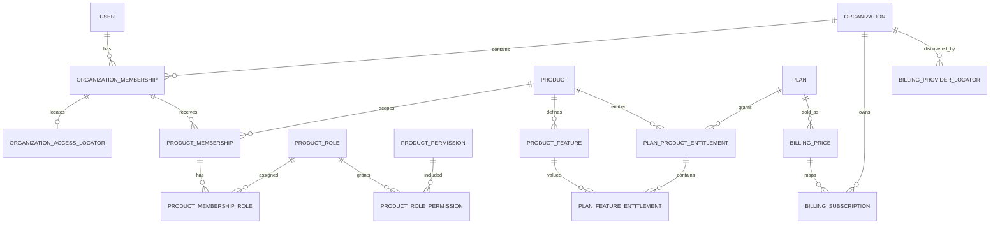

# Data Model

Status: Proposed
Last updated: 2026-07-15

## 1. Purpose

This document is the canonical relational model for the production MVP. It
defines ownership, names, relationships, indexes, foreign keys, and database
constraints. Account/session migrations and the organization foundation exist;
the remaining tables below are planned in the execution order documented here.

Behavioral interpretation is defined in
[Authorization Model](authorization_model.md) and
[Billing Model](billing_model.md).

## 2. Conventions

- PostgreSQL is authoritative. All required associations have foreign keys and
  supporting indexes.
- Rails bigint primary keys are used for internal records. Public security
  tokens use UUIDs, high-entropy random tokens, or purpose-scoped Rails signed
  tokens whose expiry and invalidating state are explicit.
- Every table has non-null `created_at` and `updated_at` unless explicitly an
  append-only ledger with a more specific timestamp.
- Required strings are `NOT NULL` and protected by a non-blank `btrim` check.
- Enumerated strings have database check constraints. Application enums mirror,
  but do not replace, those constraints.
- Time is stored in UTC. Boundary checks use an injected `now` in application
  services so tests are deterministic.
- Foreign-key delete behavior defaults to `RESTRICT`/`NO ACTION`. The only MVP
  cascades are ephemeral sessions and pure child/join rows explicitly listed in
  section 11. Security and billing history never cascades from an ordinary UI
  operation.
- Every tenant-owned table contains a non-null `organization_id`, even when it
  can be derived through another relationship.
- Composite foreign keys prevent cross-organization and cross-product joins.
- Product, feature, role, and plan keys use lowercase ASCII snake case and are
  immutable after publish. Permission keys use dot-separated lowercase
  snake-case segments, for example `projects.create`.

## 3. Ownership classes

| Ownership | Tables | Query rule |
| --- | --- | --- |
| Global account | `users`, `sessions` | Through authenticated account/session |
| Tenant-owned | organizations' memberships, invitations, product assignments, checkout attempts, subscriptions, product-domain records | Through `Current.organization` after bootstrap |
| Global system catalog | products, features, plans, entitlements, product roles/permissions, billing prices | Read through explicit catalog services; writes are deployment-controlled |
| Global locator infrastructure | `organization_access_locators`, `billing_provider_locators` | Discovery only; never sufficient authorization; immediately reload tenant records through `Current.organization` |
| Provider ingress ledger | `billing_webhook_events` | No ordinary user query; verified system resolver, then tenant reload when associated |

`organizations` is the tenant root. Global locator rows may identify a candidate
tenant but never grant access. After setting the candidate root, every
tenant-owned child query, including the authoritative membership/subscription
check, is reloaded through `Current.organization`. The bootstraps are documented
in [Authorization Model](authorization_model.md#7-context-establishment-boundaries).

## 4. Relationship overview

## 5. Accounts and tenancy

### 5.1 `User` / `users`

Planned columns:

- `name`: trimmed, non-blank text, not null.
- `email_address`: normalized lowercase text, not null.
- `password_digest`: not null.
- `email_verified_at`: nullable; non-null means the current normalized email
  address has been verified.
- `system_role`: `user` or `platform_admin`, not null, default `user`.
- `disabled_at`: nullable; non-null means the account cannot authenticate or
  authorize.

Constraints and indexes:

- unique functional index on `lower(email_address)`;
- checks that `name` is trimmed/non-blank and that the stored email is trimmed,
  lowercase, and non-blank;
- check that `system_role` is in the allowlist; the default role is `user` and
  no platform-admin interface is part of the MVP;
- unverified or disabled users cannot establish a new session or tenant
  context;
- disabling an account is allowed only through the locked ownership service
  described below.

Authentication secrets are one-way digests. Plain passwords are never stored.
Registration creates only the global account and sends verification; it does
not create an organization or tenant membership.

### 5.2 `Session` / `sessions`

- `user_id`: not-null foreign key to `users`, `ON DELETE CASCADE`; sessions are
  ephemeral, while any future user hard-deletion workflow remains separately
  authorized and audited.
- `token_digest`: not-null lowercase 64-character SHA-256 hex digest of an
  opaque high-entropy cookie token; globally unique. The raw token is persisted
  only in the browser cookie, handled transiently by the request, and never
  stored server-side or logged.
- `expires_at`: not null and set to 30 days after session creation.
- optional `ip_address`, `user_agent`, and `last_seen_at`, with bounded lengths.

Index `user_id`; add a unique index and lowercase-hex shape check for
`token_digest`, plus a check that `expires_at > created_at`. A login rotates
browser and server session state. Logout, password reset, account disablement,
and security-sensitive changes revoke applicable server-side sessions without
deleting business history.

Password reset and email verification do not add plaintext-token columns.
They use purpose-scoped Rails signed tokens bound to invalidating user state.
Password-reset tokens expire after 15 minutes and become invalid when the
password changes; email-verification tokens expire after 24 hours and become
invalid when the current email is verified or changed. Successful mutation is
therefore single-use. Token-bearing `GET` requests render confirmation only;
the state transition requires a CSRF-protected `PATCH`.

### 5.3 `Organization` / `organizations`

- `public_id`: UUID with a PostgreSQL `gen_random_uuid()` default for external
  references, not null.
- `name`: trimmed, non-blank text, at most 100 characters.
- `slug`: lowercase ASCII slug, immutable in the MVP.
- `status`: `active` or `suspended`, not null, default `active`.

Constraints and indexes:

- unique index on `public_id`;
- unique index on `slug`;
- slug check `^[a-z0-9]+(?:-[a-z0-9]+)*$` with length from 1 through 63;
- name trimmed/non-blank/maximum-length check;
- check that `status` is in the allowlist and an index on `status`.

An active organization may establish ordinary tenant context once path bootstrap
is enabled. A suspended organization authorizes no tenant access. Suspending an
organization and organization archive/hard deletion remain separate lifecycle
operations; neither is exposed by the initial tenant-foundation change.

There is no `owner_id` column. Ownership has one source:
`organization_memberships.role = 'owner'`.

For verified and authenticated onboarding, `Organizations::Create` inserts the
active organization and first active owner membership in one database
transaction after locking and validating the authoritative user row. It assigns
`Current.organization` and `Current.membership` only after the
outermost database transaction commits.
Registration and email verification do not invoke this command automatically.

### 5.4 `OrganizationMembership` / `organization_memberships`

- `organization_id`: not-null foreign key to `organizations`.
- `user_id`: not-null foreign key to `users`.
- `role`: `owner`, `admin`, `billing`, or `member`.
- `status`: `active` or `suspended`, not null, default `active`.
- `joined_at`: not-null timestamp recording the first successful join.

Constraints and indexes:

- unique `(organization_id, user_id)`;
- check allowed `role` and `status`;
- unique supporting tuples `(id, organization_id)` and
  `(id, user_id, organization_id)` for composite child/locator foreign keys;
- indexes on `user_id` and `(organization_id, status, role)`.
- a deferred PostgreSQL constraint trigger locks the organization root at commit
  and rejects organization creation, membership deletion, demotion, suspension,
  or reassignment when the committed state would contain no active owner.

The deferred trigger permits `Organizations::Create` to insert the organization
before its first owner inside one transaction while still enforcing the
cross-row invariant at commit. The primary database uses `db/structure.sql` so
fresh schema loads preserve the function and triggers.

`Organizations::Memberships::Remove` soft-suspends a membership rather than
deleting it, so actor history and billing-attempt relationships remain stable.
Once product assignments and the global access locator exist, suspension also
removes them atomically; reactivation never resurrects product assignments and
does not change `joined_at`. `Organizations::Memberships::ChangeRole` and
`Organizations::Memberships::Remove` resolve the target through
`Current.organization.organization_memberships`, lock the organization, and
prevent demoting or suspending the final **active** owner. Multiple active owners
are valid. A separate access-eligible owner is an active owner membership whose
user is not disabled. Before an account-disable mutation is exposed, its global
guard must enumerate only access-locator candidates, establish each
`Current.organization`, and lock roots in stable ID order before allowing a
disable transition that would leave no access-eligible owner.

### 5.5 `OrganizationAccessLocator` / `organization_access_locators`

A global, non-authoritative discovery index for authenticated organization
switching and path bootstrap. It was introduced after the initial organization
foundation; its migration backfills all existing active memberships and must
complete successfully before ordinary tenant paths are enabled.

- `organization_membership_id`, `user_id`, `organization_id`: not null.

Constraints and indexes:

- unique `organization_membership_id` and unique `(user_id, organization_id)`;
- composite foreign key
  `(organization_membership_id, user_id, organization_id)` to
  `organization_memberships(id, user_id, organization_id)`, delete restricted;
- indexes supporting `user_id` plus organization slug lookup.

The locator exists only for an active membership and is created/deleted in the
same locked transaction as membership activation/suspension. Account disable
leaves this non-authoritative discovery row in place so a cross-organization
ownership check and any future controlled recovery can find the same roots;
disabled-user authentication and the tenant membership reload still deny. It is
not authorization: a request uses it only to select a candidate organization,
sets
`Current.organization`, and reloads the active membership through
`Current.organization.organization_memberships`. A stale locator therefore
fails closed.

### 5.6 `OrganizationInvitation` / `organization_invitations`

- `organization_id`: not-null foreign key.
- `inviter_id`: not-null user foreign key. A composite tenant foreign key also
  proves that this user has an organization membership.
- `email_address`: normalized lowercase invite target.
- `organization_role`: invited organization role.
- `status`: `pending`, `accepted`, `revoked`, or `expired`.
- `token_digest`: one-way digest of a high-entropy token.
- `expires_at`, `accepted_at`, `revoked_at`.

Constraints and indexes:

- globally unique `token_digest`;
- partial unique index on `(organization_id, lower(email_address)) WHERE
  status = 'pending'`;
- composite foreign key
  `(organization_id, inviter_id)` to
  `organization_memberships(organization_id, user_id)`;
- role, status, and timestamp consistency checks.

Invitation acceptance locks the invitation, validates the authenticated email,
and creates or reactivates the unique organization membership atomically. The
create service first marks any elapsed pending invitation `expired` in the same
serialized workflow, because a partial-index predicate cannot depend on
`now()`. Invitations expire after seven days. Creating an invitation for an
email that already has an unexpired pending invitation returns that same row
without rotating or re-sending its token; the explicit resend command rotates
the digest and expiry. The invitation itself never authorizes tenant access.

## 6. Global catalog and plan entitlements

### 6.1 `Product` / `products`

- `key`: globally unique stable lowercase snake-case identifier.
- `name`: display name.
- `state`: `active` or `retired`.

Retiring a product blocks new plan/RBAC/product-membership assignment but does
not delete or silently revoke historical references. Existing published plans
and assignments continue to evaluate until customers are explicitly migrated to
a new plan/assignment graph. An emergency global product kill switch, if ever
needed, is a separate audited security control rather than overloaded `state`.

### 6.2 `ProductFeature` / `product_features`

- `product_id`: not-null foreign key to `products`, delete restricted.
- `key`: stable within the product.
- `name`: display name.
- `value_type`: `boolean` or `integer_limit`.
- `state`: `active` or `retired`.
- `unit`: null for boolean features; non-blank stable unit name for numeric
  features, such as `projects` or `seats`.

Constraints and indexes:

- unique `(product_id, key)`;
- check allowed `value_type` and `state`;
- explicit typed unit check: boolean requires `unit IS NULL`; integer-limit
  requires `unit IS NOT NULL AND btrim(unit) <> ''`;
- unique `(id, product_id, value_type)` to support a composite entitlement
  foreign key.

A feature key is not a permission key. Product code maintains an explicit
registry from each numeric feature key to its authoritative usage query and
atomic consuming operation. Arbitrary constant lookup from database text is
prohibited.

Retirement blocks new draft-plan references but preserves existing published
plan behavior until an explicit plan-version migration.

### 6.3 `Plan` / `plans`

- `key`: stable offering family, such as `starter`.
- `version`: positive integer.
- `name`: display name.
- `state`: `draft`, `published`, or `retired`.
- `published_at`, `retired_at`.

Constraints and indexes:

- unique `(key, version)`;
- positive version check;
- lifecycle state/timestamp checks.

Once published, the plan and its entitlement rows are immutable. Changes create
a new version. A Lemon Squeezy variant mapping can be created only for one exact
currently published version; moving customers requires an explicit provider
variant/subscription transition.
Lifecycle is one-way `draft -> published -> retired`. Retirement blocks new
billing-price mappings and new checkout selection, but does not rewrite or
revoke the immutable entitlements used by already synchronized subscriptions.

### 6.4 `PlanProductEntitlement` / `plan_product_entitlements`

- `plan_id`: not-null foreign key to `plans`, delete restricted.
- `product_id`: not-null foreign key to `products`, delete restricted.

Presence grants base product entitlement. Constraints:

- unique `(plan_id, product_id)`, which is also the parent composite key for
  feature entitlements;
- supporting index on `product_id`.

Absence denies the product.

### 6.5 `PlanFeatureEntitlement` / `plan_feature_entitlements`

- `plan_id`, `product_id`, `product_feature_id`: not null.
- `value_type`: copied from the referenced feature for a database-enforceable
  composite relationship.
- `boolean_value`: nullable boolean.
- `limit_value`: nullable bigint.

Foreign keys:

- `(plan_id, product_id)` to
  `plan_product_entitlements(plan_id, product_id)`;
- `(product_feature_id, product_id, value_type)` to
  `product_features(id, product_id, value_type)`.

Constraints and indexes:

- unique `(plan_id, product_feature_id)`;
- for `boolean`, `boolean_value` is non-null and `limit_value` is null;
- for `integer_limit`, `boolean_value` is null and
  `limit_value IS NOT NULL AND limit_value >= 0`;
- no negative or `-1 means unlimited` sentinel.

This shape prevents a feature entitlement without its product entitlement,
wrong-product feature attachment, and value-type drift.

## 7. Product RBAC

### 7.1 `ProductRole` / `product_roles`

- `product_id`: not-null foreign key.
- `key`: stable within product.
- `name`: display name.
- `state`: `active` or `retired`.

Unique `(product_id, key)` and unique supporting tuple `(id, product_id)`.
Roles are system-defined in the MVP. Retirement blocks new assignments but
existing assignments continue until an explicit assignment migration; it is not
an implicit permission revocation mechanism.

### 7.2 `ProductPermission` / `product_permissions`

- `product_id`: not-null foreign key.
- `key`: stable action capability within product, such as `projects.create`.
- `name`: display name.
- `state`: `active` or `retired`.

Unique `(product_id, key)`, unique supporting tuple `(id, product_id)`, and an
allowed-state check. Permissions are positive grants; there is no explicit deny
row. Retirement blocks new role mappings but existing reviewed role mappings
continue until an explicit role-version/mapping transition.

### 7.3 `ProductRolePermission` / `product_role_permissions`

- `product_id`, `product_role_id`, `product_permission_id`: not null.

Composite foreign keys:

- `(product_role_id, product_id)` to `product_roles(id, product_id)`;
- `(product_permission_id, product_id)` to
  `product_permissions(id, product_id)`.

Unique `(product_role_id, product_permission_id)`. Including `product_id` in
both composite relationships prevents cross-product grants.

### 7.4 `ProductMembership` / `product_memberships`

- `organization_id`: not-null tenant foreign key.
- `organization_membership_id`: not null.
- `product_id`: not-null foreign key.

Constraints and indexes:

- composite foreign key `(organization_membership_id, organization_id)` to
  `organization_memberships(id, organization_id)`;
- unique `(organization_id, organization_membership_id, product_id)`;
- unique supporting tuple `(id, organization_id, product_id)`;
- index `(organization_id, product_id)`.

Do not duplicate `user_id`. A product membership can exist while its plan
entitlement is absent; it is then dormant and grants nothing.

### 7.5 `ProductMembershipRole` / `product_membership_roles`

- `organization_id`, `product_id`, `product_membership_id`, `product_role_id`:
  not null.

Composite foreign keys:

- `(product_membership_id, organization_id, product_id)` to
  `product_memberships(id, organization_id, product_id)`;
- `(product_role_id, product_id)` to `product_roles(id, product_id)`;
- `organization_id` to `organizations` for explicit tenant ownership.

Unique `(product_membership_id, product_role_id)`. Multiple roles are allowed;
their permission union is evaluated at runtime. A role-less membership grants
no product action.

## 8. Billing

### 8.1 `Billing::Price` / `billing_prices`

A global allowlist created by mapping an exact Lemon Squeezy variant to an exact
currently published plan version; the historical mapping survives later plan
retirement.

- `plan_id`: not-null foreign key, delete restricted.
- `provider`: checked to `lemon_squeezy` in the MVP.
- `environment`: `test` or `live`.
- `provider_store_id`, `provider_product_id`, `provider_variant_id`: non-blank
  text.
- `active`: non-null boolean.
- optional display-only billing interval/label; provider remains authoritative
  for price and tax.

Indexes and constraints:

- unique `(provider, environment, provider_store_id, provider_variant_id)`;
- index `plan_id`;
- supporting unique `(id, provider, environment)` for checkout attempts;
- supporting unique
  `(id, provider, environment, provider_store_id, provider_product_id,
  provider_variant_id)` for subscriptions.

Multiple billing prices can map to one plan version. A plan version change
requires a distinct provider variant or an explicit migration strategy;
silently repointing a used price is prohibited.

The mapping service accepts only a currently `published` plan. `active` controls
new checkout selection only, which also rechecks that the plan remains
published. Retiring a plan therefore blocks checkout even if a price's `active`
flag has not yet been cleared; Billing may deactivate those prices as
housekeeping without changing historical meaning. An inactive historical price
continues to resolve existing subscriptions to its immutable
published-then-retired plan version.

### 8.2 `Billing::CheckoutAttempt` / `billing_checkout_attempts`

- `organization_id`: not-null tenant foreign key.
- `initiated_by_membership_id`: not null, composite tenant foreign key.
- `billing_price_id`: not-null foreign key.
- `provider`: `lemon_squeezy`.
- `environment`: `test` or `live`, matching the billing price.
- `token_digest`: SHA-256 digest of a transient high-entropy correlation token,
  not null; plaintext is never persisted.
- `state`: `creating`, `ready`, `creation_unknown`, `completed`, `expired`,
  `superseded`, or `failed`.
- `provider_checkout_id`: nullable provider identifier.
- optional encrypted `provider_checkout_url`, cleared after completion/expiry.
- non-null `expires_at`; nullable `token_consumed_at`, `completed_at`, and
  redacted `failure_code`.

Constraints and indexes:

- globally unique 64-character hex `token_digest`;
- composite foreign key
  `(initiated_by_membership_id, organization_id)` to membership;
- composite foreign key `(billing_price_id, provider, environment)` to the same
  tuple on `billing_prices`;
- unique `(provider, environment, provider_checkout_id)` when the checkout ID is
  present;
- supporting unique tuple
  `(id, organization_id, billing_price_id, provider, environment)` for a
  subscription foreign key;
- supporting unique
  `(id, organization_id, provider, environment, token_digest)` for the verified
  provider locator;
- partial unique index allowing one `creating`, `ready`, or `creation_unknown`
  row per organization;
- state/timestamp consistency checks.

`failed` is reserved for a definitive local/provider rejection proving that no
usable remote checkout was created. `expired` means only that the URL/correlation
window elapsed; it is not evidence that no purchase occurred before expiry.

All application reads use
`Current.organization.billing_checkout_attempts`. Before creating a new attempt,
the locked service marks pending attempts `expired` when
`now >= expires_at + 10 minutes`; a sweeper performs the same idempotent
transition. The extra ten minutes is a local delivery grace period and keeps the
static partial index executable without a volatile `now()` predicate.

A delayed verified subscription may consume a retained expired attempt when the
provider subscription was created no later than `expires_at + 5 minutes` (clock
skew allowance). Processing time may be later. Creation after that provider-time
boundary, a consumed token, or a mismatched locator is quarantined. Plaintext
token is transient correlation data, not proof of access.

### 8.3 `Billing::Subscription` / `billing_subscriptions`

- `organization_id`: not-null tenant foreign key.
- `billing_price_id`: not-null current provider-price mapping foreign key.
- `origin_billing_price_id`: not-null immutable original price foreign key.
- `origin_checkout_attempt_id`: not-null immutable unique foreign key.
- `provider`: `lemon_squeezy`.
- `environment`: `test` or `live`.
- `test_mode`: non-null boolean matching environment.
- `external_subscription_id`: non-blank text.
- `provider_store_id`, `provider_product_id`, `provider_variant_id`: non-blank
  text copied from the verified provider snapshot.
- optional external customer/order identifiers needed for diagnostics, never
  used to resolve a tenant by email/name.
- `provider_status`: raw bounded status text.
- `status`: normalized `on_trial`, `active`, `paused`, `past_due`, `unpaid`,
  `cancelled`, `expired`, or `unknown`.
- `sync_state`: `synced`, `pending`, `mapping_error`, or `invalid`.
- `trial_ends_at`, `renews_at`, `ends_at`, `past_due_started_at`.
- `provider_created_at`, `provider_updated_at`, `status_changed_at`,
  `last_seen_provider_updated_at`, `last_verified_webhook_at`.
- `superseded_at` and optimistic `lock_version`.

Constraints and indexes:

- unique `(provider, environment, external_subscription_id)`;
- unique non-null `origin_checkout_attempt_id`;
- supporting unique
  `(id, organization_id, provider, environment, external_subscription_id)` for
  the global provider locator;
- partial unique index on `organization_id WHERE superseded_at IS NULL`;
- foreign key to organization;
- composite foreign key
  `(billing_price_id, provider, environment, provider_store_id,
  provider_product_id, provider_variant_id)` to the same supporting unique tuple
  on `billing_prices`, enforcing the current exact mapping;
- composite foreign key
  `(origin_checkout_attempt_id, organization_id, origin_billing_price_id,
  provider, environment)` to the supporting tuple on
  `billing_checkout_attempts`, preventing cross-tenant/origin-price attachment;
- ordinary foreign key from `origin_billing_price_id` to `billing_prices`,
  delete restricted;
- check `test` implies `test_mode = true` and `live` implies false;
- normalized status and sync-state checks;
- status-specific required timestamp checks: normalized `on_trial` requires
  `trial_ends_at`, `cancelled` requires `ends_at`, and `past_due` requires
  `past_due_started_at`;
- timestamp ordering checks within one row. Monotonic comparison against the
  previously stored row is enforced by the locked conditional projection
  service, not misrepresented as a PostgreSQL `CHECK`.

`past_due_started_at` is derived from the validated provider update timestamp on
entry to a past-due cycle, remains stable through that cycle, and is cleared on
exit. A provider timestamp more than five minutes after the event's local
`received_at` is invalid rather than an access extension mechanism.

For an existing subscription, an unknown variant retains the last accepted
price/plan/provider mapping, records the unknown input only in the filtered
webhook event, advances `last_seen_provider_updated_at`, and changes
`sync_state` to `mapping_error`. Malformed or equal-timestamp-conflicting input
similarly sets `invalid`. Both deny immediately. They do not need to violate the
exact mapping foreign key. A first subscription with no valid mapping creates no
subscription row and grants nothing.

There is no `organizations.plan_id` and no separate mutable effective-plan row.
The one current, synchronized, access-granting local subscription derives its
canonical plan version through its current immutable `Billing::Price`. This
avoids two sources of entitlement truth. A verified plan change updates only the
current `billing_price_id` and matching provider identifiers; origin fields stay
unchanged.

Only `expired` is terminal for starting a replacement subscription in the MVP.
When a verified new subscription is correlated after an expired current row,
the locked transaction sets the old row's `superseded_at` before inserting the
new current row. Any second subscription while the current row is not expired is
quarantined. Later events for a superseded external ID update that historical
row for audit but never make it current or access-granting.

### 8.4 `Billing::ProviderLocator` / `billing_provider_locators`

A global, non-authoritative integration index used only after webhook signature
verification.

- `provider`, `environment`, `organization_id`, and `kind` (`checkout` or
  `subscription`): not null.
- checkout shape: `checkout_attempt_id` and `checkout_token_digest`.
- subscription shape: `external_subscription_id` and optional
  `billing_subscription_id` until a valid first projection can be created.
- nullable `resolved_at` and `resolution` (`consumed` or
  `definitive_creation_failure`) for checkout correlation; both are null or both
  are present.

Constraints and indexes:

- exact shape check: checkout fields are present only for `checkout`; external
  subscription fields are present only for `subscription`;
- checkout resolution timestamp/reason consistency; subscription locators have
  neither checkout resolution field;
- unique `(provider, environment, checkout_token_digest)` when present;
- unique `(provider, environment, external_subscription_id)` when present;
- unique non-null checkout-attempt and billing-subscription references;
- organization foreign key, delete restricted;
- composite checkout foreign key
  `(checkout_attempt_id, organization_id, provider, environment,
  checkout_token_digest)` to a matching supporting unique tuple on
  `billing_checkout_attempts`;
- when a subscription row exists, composite foreign key
  `(billing_subscription_id, organization_id, provider, environment,
  external_subscription_id)` to the matching tuple on
  `billing_subscriptions`.

Checkout attempt creation inserts its locator atomically. Once a verified first
subscription has trusted token, tenant, provider, store, environment, and
provider-created-time correlation, one transaction marks the checkout locator
`consumed` and creates its subscription locator even if exact variant/plan
mapping still fails; `billing_subscription_id` is filled only after a valid
projection succeeds. If base correlation is untrusted, neither locator is
changed. A definitive creation rejection may resolve the checkout locator as
`definitive_creation_failure`; timeout, readiness, abandonment, or expiry alone
never resolves it. Ordinary code cannot query this table. The verified resolver
uses it to select a candidate organization, sets `Current.organization`, and
reloads every checkout/subscription row through that tenant.

For correlation and operational status, a checkout locator is unresolved while
`resolved_at IS NULL`; a subscription locator is unresolved while
`billing_subscription_id IS NULL`. Locator rows are retained after resolution
for idempotency and history.

### 8.5 `Billing::WebhookEvent` / `billing_webhook_events`

A provider-wide durable receipt ledger. It is not an ordinary tenant resource.

- `provider`, configured `environment`, and nullable bounded `event_name` from
  signed `meta.event_name`; it is null only when a verified raw body cannot be
  parsed and is never populated authoritatively from `X-Event-Name`.
- `fingerprint`: 64-character SHA-256 hex of provider, configured environment,
  and exact raw body. Mutable request headers are deliberately excluded.
- nullable bounded `resource_type`, `external_resource_id`,
  `provider_store_id`, and `test_mode`; processable states require the complete
  supported subscription shape, while ignored/quarantined malformed envelopes
  may retain only fields that were safely parsed.
- nullable `checkout_attempt_token_digest`, computed immediately after signature
  verification from allowlisted `meta.custom_data`; plaintext custom data is
  never persisted.
- `provider_updated_at` when present.
- nullable `organization_id`, set only after trusted resolution.
- `state`: `received`, `processing`, `processed`, `ignored`, `quarantined`, or
  `failed`.
- `verified_at`, `verification_key_version`, `received_at`, `processed_at`,
  `attempt_count`, and redacted `error_code`.
- optional allowlisted normalized `snapshot` JSONB, constrained to an object.

Constraints and indexes:

- unique `fingerprint`;
- checks for fixed fingerprint shape, enums, non-negative attempts, timestamp
  consistency, environment/test-mode agreement when present, and complete
  non-null supported envelope fields for processable states;
- index `(state, received_at)` for sweepers;
- index `(provider, environment, external_resource_id)`;
- nullable foreign key/index on `organization_id`.

Lemon Squeezy does not currently document a unique delivery ID, so the local
content fingerprint is the receipt idempotency key. The signature is excluded
from the fingerprint so secret rotation cannot bypass duplicate detection.

Do not persist raw bodies, signatures, plaintext custom tokens, emails, customer
names, API keys, or signed checkout/portal URLs in this ledger. After
verification, persist only the fields/digests required to locate, refetch, and
project the provider resource.

## 9. Audit events

### 9.1 `AuditEvent` / `audit_events`

An append-only, tenant-owned security/business audit record for the sensitive
transitions listed in [Authorization Model](authorization_model.md#10-audit-requirements).
It is introduced by the audit/membership-administration follow-up rather than the
initial organization-foundation change; no retroactive events are fabricated.

- `organization_id`: not-null foreign key, delete restricted.
- `actor_user_id`: nullable user foreign key, delete restricted; null represents
  an authenticated provider/system action.
- `action`: non-blank stable dot-separated action code.
- `subject_type`, `subject_id`: bounded descriptors, not treated as a
  polymorphic relational foreign key.
- `request_id`, `job_id`: nullable bounded correlation IDs.
- `metadata`: non-null JSONB object containing allowlisted non-sensitive IDs and
  reason codes only.
- `occurred_at`: non-null event time.

Indexes support `(organization_id, occurred_at)` and `action`. Application
models expose create/read only; ordinary application code cannot update rows.
A single recording service verifies that every non-organization subject carries
the same `organization_id` and accepts only typed, explicitly allowlisted
metadata keys; arbitrary nested values, emails, and token material are rejected.
A dedicated retention service may delete expired rows under the documented
policy and audit that operation. Tenant UI/support queries, if added, are rooted
at `Current.organization.audit_events`.

## 10. Product-owned tenant data and numeric usage

Every product-domain table must:

- include non-null `organization_id` and an organization foreign key;
- be loaded from a `Current.organization` association;
- include composite ownership foreign keys when it references another
  tenant/product row;
- define the authoritative usage query for each numeric feature it consumes.

The MVP does not introduce a generic usage ledger. Current-capacity features use
the product's authoritative records or a product-owned counter maintained in the
same transaction. If a future feature needs time-window metering, it requires a
separate ADR and data model; `-1` or a null limit must not be overloaded as
unlimited.

## 11. Lifecycle, deletion, and foreign-key policy

| Record | MVP behavior |
| --- | --- |
| User | Disable; hard deletion requires a separate privacy workflow |
| Organization | Retain; organization archive and hard deletion are outside the MVP |
| Membership | Soft-suspend; service deletes product memberships/role joins and the global access locator atomically once those records exist |
| Invitation | Revoke/expire; retain minimal audit metadata for a bounded period |
| Product/feature/role/permission | Retire; restrict deletion when referenced |
| Published plan/entitlements | Immutable; restrict deletion |
| Checkout attempt/subscription/webhook | Retain per billing/security retention policy; never cascade from ordinary UI operations |

Default foreign-key deletion is `RESTRICT`/`NO ACTION`. Intentional database
cascades are limited to:

- sessions when a separately approved user hard-deletion workflow deletes a
  user;
- `product_membership_roles` when the audited suspension/assignment service
  deletes a product membership.

PostgreSQL cascades cannot be conditional on parent lifecycle. Draft-plan
editing therefore explicitly deletes feature-entitlement children before their
plan-product parent in one service transaction; catalog role/permission joins
are handled the same way. Their foreign keys remain `RESTRICT`, so deleting a
published/retired or referenced parent cannot silently cascade.

Published catalog/plan data, organizations, memberships, invitations, audit
events, billing attempts/subscriptions/locators/webhook events, and provider
history are delete-restricted or explicitly retained. Application lifecycle/
suspension services perform allowed child transitions before changing the
parent state; there is no broad organization cascade.

## 12. Migration rules

Each implementation migration must include, in the same coherent PR:

1. all foreign keys and their intended delete behavior;
2. unique and partial unique indexes for business identities;
3. check constraints for enums, non-blank text, typed values, and ranges;
4. composite unique indexes required by composite foreign keys;
5. indexes supporting tenant-rooted and job-sweeper query paths;
6. reversible or explicitly documented expand/backfill/contract behavior;
7. constraint tests, including direct invalid writes when model validation could
   mask a database omission.

Large table migrations later use additive nullable columns, backfills, validated
constraints, and a later contract PR. The greenfield MVP can create required
columns as non-null from the start.

## 13. Data-model acceptance tests

- Duplicate organization slug, membership, product assignment, plan-product
  entitlement, role-permission join, and provider subscription IDs fail.
- Database checks reject invalid roles/statuses, negative limits, malformed
  typed feature values, blank stable keys, and environment/test-mode mismatch.
- Composite foreign keys reject cross-organization product membership and
  cross-product permission/role/feature joins.
- An entitlement cannot reference a feature unless its plan also grants that
  feature's product.
- One checkout attempt cannot activate two subscriptions, and an organization
  cannot have two current subscriptions or concurrent pending checkouts.
- Published plan data cannot be modified through application write paths.
- Sequential, concurrent, and direct database membership transitions cannot
  remove the last active owner; the account-disable follow-up separately
  prevents disabling the last access-eligible owner across organizations.
- Suspend/reactivate never restores prior product assignments.
- Global access/provider locators can select only a candidate tenant; stale or
  mismatched locators fail the tenant reload and authorize nothing.
