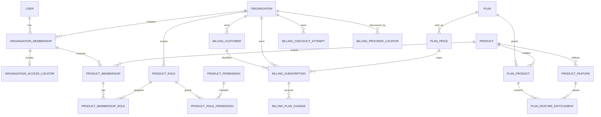

# Data Model

Status: Proposed
Last updated: 2026-07-16

## 1. Purpose

This document is the canonical relational model for the production MVP. It
defines ownership, names, relationships, indexes, foreign keys, and database
constraints. Account/session, organization, invitation/audit, and local catalog
migrations exist. A constrained Billing persistence foundation, read-only
Entitlements resolver, and product-RBAC persistence/services also exist, but
provider mapping, locator, verified projection, Pundit/UI integration, the full
`Access::Decision` composition, and product-domain work remain planned in the
documented execution order.

Behavioral interpretation is defined in
[Authorization Model](authorization_model.md) and
[Billing Model](billing_model.md).

## 2. Conventions

- PostgreSQL is authoritative. All required associations have foreign keys and
  supporting indexes.
- Rails bigint primary keys are used for internal records. Public security
  tokens use UUIDs, high-entropy random tokens, or purpose-scoped Rails signed
  tokens whose expiry and invalidating state are explicit.
- Every table has non-null `created_at` and `updated_at` unless explicitly an
  append-only ledger with a more specific timestamp.
- Required strings are `NOT NULL` and protected by a non-blank `btrim` check.
- Enumerated strings have database check constraints. Application enums mirror,
  but do not replace, those constraints.
- Time is stored in UTC. Boundary checks use an injected `now` in application
  services so tests are deterministic.
- Foreign-key delete behavior defaults to `RESTRICT`/`NO ACTION`. The only MVP
  cascades are ephemeral sessions and pure child/join rows explicitly listed in
  section 11. Security and billing history never cascades from an ordinary UI
  operation.
- Every tenant-owned table contains a non-null `organization_id`, even when it
  can be derived through another relationship.
- Composite foreign keys prevent cross-organization and cross-product joins.
- Product, feature, role, and plan keys use lowercase ASCII snake case and are
  stable identities that are not renamed in place. Permission keys use dot-separated lowercase
  snake-case segments, for example `projects.create`.

## 3. Ownership classes

| Ownership | Tables | Query rule |
| --- | --- | --- |
| Global account | `users`, `sessions` | Through authenticated account/session |
| Tenant-owned | organizations' memberships, invitations, product assignments, organization-specific product roles, billing customers, checkout attempts, subscriptions, plan changes, product-domain records | Through `Current.organization` after bootstrap |
| Global system catalog | products, features, plans, plan products, feature entitlements, plan prices, system product roles, and product permissions | Read through explicit catalog/Access services; writes are deployment-controlled |
| Global locator infrastructure | `organization_access_locators`, `billing_provider_locators` | Discovery only; never sufficient authorization; immediately reload tenant records through `Current.organization` |
| Provider ingress ledger | `billing_webhook_events` | No ordinary user query; verified system resolver, then tenant reload when associated |

`organizations` is the tenant root. Global locator rows may identify a candidate
tenant but never grant access. After setting the candidate root, every
tenant-owned child query, including the authoritative membership/subscription
check, is reloaded through `Current.organization`. The bootstraps are documented
in [Authorization Model](authorization_model.md#7-context-establishment-boundaries).

## 4. Relationship overview

## 5. Accounts and tenancy

### 5.1 `User` / `users`

Planned columns:

- `name`: trimmed, non-blank text, not null.
- `email_address`: normalized lowercase text, not null.
- `password_digest`: not null.
- `email_verified_at`: nullable; non-null means the current normalized email
  address has been verified.
- `system_role`: `user` or `platform_admin`, not null, default `user`.
- `disabled_at`: nullable; non-null means the account cannot authenticate or
  authorize.

Constraints and indexes:

- unique functional index on `lower(email_address)`;
- checks that `name` is trimmed/non-blank and that the stored email is trimmed,
  lowercase, and non-blank;
- check that `system_role` is in the allowlist; the default role is `user` and
  no platform-admin interface is part of the MVP;
- unverified or disabled users cannot establish a new session or tenant
  context;
- disabling an account is allowed only through the locked ownership service
  described below.

Authentication secrets are one-way digests. Plain passwords are never stored.
Registration creates only the global account and sends verification; it does
not create an organization or tenant membership.

### 5.2 `Session` / `sessions`

- `user_id`: not-null foreign key to `users`, `ON DELETE CASCADE`; sessions are
  ephemeral, while any future user hard-deletion workflow remains separately
  authorized and audited.
- `token_digest`: not-null lowercase 64-character SHA-256 hex digest of an
  opaque high-entropy cookie token; globally unique. The raw token is persisted
  only in the browser cookie, handled transiently by the request, and never
  stored server-side or logged.
- `expires_at`: not null and set to 30 days after session creation.
- optional `ip_address`, `user_agent`, and `last_seen_at`, with bounded lengths.

Index `user_id`; add a unique index and lowercase-hex shape check for
`token_digest`, plus a check that `expires_at > created_at`. A login rotates
browser and server session state. Logout, password reset, account disablement,
and security-sensitive changes revoke applicable server-side sessions without
deleting business history.

Password reset and email verification do not add plaintext-token columns.
They use purpose-scoped Rails signed tokens bound to invalidating user state.
Password-reset tokens expire after 15 minutes and become invalid when the
password changes; email-verification tokens expire after 24 hours and become
invalid when the current email is verified or changed. Successful mutation is
therefore single-use. Token-bearing `GET` requests render confirmation only;
the state transition requires a CSRF-protected `PATCH`.

### 5.3 `Organization` / `organizations`

- `public_id`: UUID with a PostgreSQL `gen_random_uuid()` default for external
  references, not null.
- `name`: trimmed, non-blank text, at most 100 characters.
- `slug`: lowercase ASCII slug, immutable in the MVP.
- `status`: `active` or `suspended`, not null, default `active`.

Constraints and indexes:

- unique index on `public_id`;
- unique index on `slug`;
- slug check `^[a-z0-9]+(?:-[a-z0-9]+)*$` with length from 1 through 63;
- name trimmed/non-blank/maximum-length check;
- check that `status` is in the allowlist and an index on `status`.

An active organization may establish ordinary tenant context once path bootstrap
is enabled. A suspended organization authorizes no tenant access. Suspending an
organization and organization archive/hard deletion remain separate lifecycle
operations; neither is exposed by the initial tenant-foundation change.

There is no `owner_id` column. Ownership has one source:
`organization_memberships.role = 'owner'`.

For verified and authenticated onboarding, `Organizations::Create` inserts the
active organization and first active owner membership in one database
transaction after locking and validating the authoritative user row. It assigns
`Current.organization` and `Current.membership` only after the
outermost database transaction commits.
Registration and email verification do not invoke this command automatically.

### 5.4 `OrganizationMembership` / `organization_memberships`

- `organization_id`: not-null foreign key to `organizations`.
- `user_id`: not-null foreign key to `users`.
- `role`: `owner`, `admin`, `billing`, or `member`.
- `status`: `active` or `suspended`, not null, default `active`.
- `joined_at`: not-null timestamp recording the first successful join.

Constraints and indexes:

- unique `(organization_id, user_id)`;
- check allowed `role` and `status`;
- unique supporting tuples `(id, organization_id)` and
  `(id, user_id, organization_id)` for composite child/locator foreign keys;
- indexes on `user_id` and `(organization_id, status, role)`.
- a deferred PostgreSQL constraint trigger locks the organization root at commit
  and rejects organization creation, membership deletion, demotion, suspension,
  or reassignment when the committed state would contain no active owner.

The deferred trigger permits `Organizations::Create` to insert the organization
before its first owner inside one transaction while still enforcing the
cross-row invariant at commit. The primary database uses `db/structure.sql` so
fresh schema loads preserve the function and triggers.

`Organizations::Memberships::Remove` soft-suspends a membership rather than
deleting it, so actor history and billing-attempt relationships remain stable.
Once product assignments and the global access locator exist, suspension also
removes them atomically; reactivation never resurrects product assignments and
does not change `joined_at`. `Organizations::Memberships::ChangeRole` and
`Organizations::Memberships::Remove` resolve the target through
`Current.organization.organization_memberships`, lock the organization, and
prevent demoting or suspending the final **active** owner. Multiple active owners
are valid. A separate access-eligible owner is an active owner membership whose
user is not disabled. Before an account-disable mutation is exposed, its global
guard must enumerate only access-locator candidates, establish each
`Current.organization`, and lock roots in stable ID order before allowing a
disable transition that would leave no access-eligible owner.

### 5.5 `OrganizationAccessLocator` / `organization_access_locators`

A global, non-authoritative discovery index for authenticated organization
switching and path bootstrap. It was introduced after the initial organization
foundation; its migration backfills all existing active memberships and must
complete successfully before ordinary tenant paths are enabled.

- `organization_membership_id`, `user_id`, `organization_id`: not null.

Constraints and indexes:

- unique `organization_membership_id` and unique `(user_id, organization_id)`;
- composite foreign key
  `(organization_membership_id, user_id, organization_id)` to
  `organization_memberships(id, user_id, organization_id)`, delete restricted;
- indexes supporting `user_id` plus organization slug lookup.

The locator exists only for an active membership and is created/deleted in the
same locked transaction as membership activation/suspension. Account disable
leaves this non-authoritative discovery row in place so a cross-organization
ownership check and any future controlled recovery can find the same roots;
disabled-user authentication and the tenant membership reload still deny. It is
not authorization: a request uses it only to select a candidate organization,
sets
`Current.organization`, and reloads the active membership through
`Current.organization.organization_memberships`. A stale locator therefore
fails closed.

### 5.6 `OrganizationInvitation` / `organization_invitations`

- `organization_id`: not-null foreign key.
- `inviter_id`: not-null user foreign key. A composite tenant foreign key also
  proves that this user has an organization membership.
- `email_address`: normalized lowercase invite target.
- `organization_role`: invited organization role.
- `status`: `pending`, `accepted`, `revoked`, or `expired`.
- `token_digest`: one-way digest of a high-entropy token.
- `expires_at`, `accepted_at`, `revoked_at`.

Constraints and indexes:

- globally unique `token_digest`;
- partial unique index on `(organization_id, lower(email_address)) WHERE
  status = 'pending'`;
- composite foreign key
  `(organization_id, inviter_id)` to
  `organization_memberships(organization_id, user_id)`;
- role, status, and timestamp consistency checks.

Invitation acceptance locks the invitation, validates the authenticated email,
and creates or reactivates the unique organization membership atomically. The
create service first marks any elapsed pending invitation `expired` in the same
serialized workflow, because a partial-index predicate cannot depend on
`now()`. Invitations expire after seven days. Creating an invitation for an
email that already has an unexpired pending invitation returns that same row
without rotating or re-sending its token; the explicit resend command rotates
the digest and expiry. The invitation itself never authorizes tenant access.

## 6. Global catalog and plan entitlements

### 6.1 `Product` / `products`

- `key`: globally unique stable lowercase snake-case identifier.
- `name`: display name.
- `description`: normalized display description, defaulting to an empty string.
- `active`: non-null boolean, default true.

`key` is the application identity and is readonly after creation. `name` and
`description` are presentation values and are never lookup or authorization
inputs. Setting `active` false removes the product from new catalog selections;
it does not delete retained references and is not an emergency authorization
kill switch.

### 6.2 `ProductFeature` / `product_features`

- `product_id`: not-null foreign key to `products`, delete restricted.
- `key`: stable within the product.
- `name`: display name.
- `description`: normalized display description, defaulting to an empty string.
- `kind`: `flag` or `limit`.
- `active`: non-null boolean, default true.

Constraints and indexes:

- unique `(product_id, key)`;
- check allowed `kind`;
- unique `(id, product_id, kind)` to support a composite entitlement
  foreign key.

A feature key is not a permission key. Product code maintains an explicit
registry from each limit feature key to its unit, authoritative usage query, and
atomic consuming operation. Arbitrary constant lookup from database text is
prohibited. `product_id`, `key`, and `kind` are readonly identities. Setting
`active` false blocks new catalog selection but does not rewrite existing rows.

### 6.3 `Plan` / `plans`

- `key`: globally unique stable identifier, such as `starter`.
- `name`: display name.
- `description`: normalized display description, defaulting to an empty string.
- `active`: non-null boolean, default true.
- `free`: non-null boolean, default false.
- `position`: non-negative integer used only for deterministic display order.

Constraints and indexes:

- unique `key`;
- partial unique index allowing at most one row where `active AND free`;
- non-negative `position` check.

`key` is readonly after creation. `free` identifies the system fallback class;
the one active free plan becomes effective when no current paid subscription is
accessible. It does not attach a plan ID to an organization, mutate a
subscription, or permit manual grants. An inactive plan is unavailable for new
catalog and future checkout selection, but changing `active` does not itself
change a local paid subscription.

### 6.4 `PlanProduct` / `plan_products`

- `plan_id`: not-null foreign key to `plans`, delete restricted.
- `product_id`: not-null foreign key to `products`, delete restricted.

Presence grants base product entitlement when the effective plan (an accessible
paid subscription plan or the active free fallback) resolves to that plan. It
grants nothing by itself. Constraints:

- unique `(plan_id, product_id)`;
- supporting unique `(id, product_id)` for the feature-entitlement composite
  foreign key;
- supporting index on `product_id`.

Absence denies the product.

### 6.5 `PlanFeatureEntitlement` / `plan_feature_entitlements`

- `plan_product_id`, `product_feature_id`: not-null restricted foreign keys.
- `product_id`: not-null integrity copy of the plan product's product.
- `feature_kind`: not-null integrity copy of the feature's `kind`.
- `enabled`: non-null master grant switch, default false.
- `limit_value`: nullable bigint.
- `unlimited`: non-null boolean, default false.
- `settings`: non-null JSONB object, default `{}`.

Foreign keys:

- `(plan_product_id, product_id)` to `plan_products(id, product_id)`;
- `(product_feature_id, product_id, feature_kind)` to
  `product_features(id, product_id, kind)`.

Constraints and indexes:

- unique `(plan_product_id, product_feature_id)`;
- `settings` must be a JSON object;
- for `flag`, `limit_value` is null and `unlimited` is false; `enabled` is the
  boolean entitlement value;
- for `limit`, exactly one capacity representation is required regardless of
  `enabled`: either `unlimited = true` with null `limit_value`, or
  `unlimited = false` with non-null `limit_value >= 0`;
- `enabled` is the master grant switch. A disabled limit entitlement may retain
  its configured finite or unlimited capacity but still denies access.

Unknown `settings` keys have no generic authorization effect. Any setting that
affects product behavior requires a code-reviewed, feature-specific schema and
registry contract before it is consumed.

This shape prevents a feature entitlement without its product entitlement,
wrong-product feature attachment, and value-type drift.

### 6.6 `PlanPrice` / `plan_prices`

A global local-catalog price belonging to one plan:

- `plan_id`: not-null restricted foreign key.
- `billing_interval`: `monthly` or `yearly`.
- `currency`: normalized three-letter uppercase currency code.
- `amount_cents`: non-negative bigint.
- nullable `lemon_store_id`, `lemon_product_id`, and `lemon_variant_id`.
- `active`: non-null boolean, default true.

The three Lemon identifiers are either all null or all present and normalized.
`lemon_variant_id` is globally unique when present. This local mapping and its
display amount are server-controlled catalog data, not payment confirmation and
not an access grant. `active` controls catalog/future checkout selection only.

`PlanPrice` does not yet model provider environment. Before a public checkout or
webhook projection is implemented, Billing must add and validate exact test/live
environment and store isolation; production code must not infer it from display
price, plan name, or runtime environment alone. Provider responses remain
authoritative for charged amount and tax.

`plan_id` is immutable after price creation in both Active Record and
PostgreSQL. A catalog change creates a new price instead of silently repointing
every subscription/history row that references the old identity.

## 7. Product RBAC

### 7.1 `ProductRole` / `product_roles`

- `product_id`: not-null foreign key.
- `organization_id`: nullable tenant foreign key; null identifies a global
  system role.
- `key`: stable within product.
- `name`: display name.
- `system`: non-null boolean.
- `active`: non-null boolean, default true.

The database requires `system = true` exactly when `organization_id IS NULL`.
Separate partial unique indexes enforce one system key per product and one key
per product/organization for organization-specific roles; PostgreSQL null
semantics must not permit duplicate system keys. Unique `(id, product_id)`
supports cross-product joins. Product, organization, key, and system scope are
immutable identities.

The MVP seeds reviewed system roles only. The schema can represent an
organization-specific role, but no customer-facing custom-role builder or
arbitrary policy editor is in scope. Inactive roles remain referenced for
history, cannot receive new assignments, and are ignored by the future runtime
authorization union. Referenced roles are deactivated, never deleted.

### 7.2 `ProductPermission` / `product_permissions`

- `product_id`: not-null foreign key.
- `key`: stable action capability within product, such as `projects.create`.
- `name`: display name.
- `description`: normalized display description, defaulting to an empty string.

Unique `(product_id, key)` and unique supporting tuple `(id, product_id)`.
Permissions are stable positive capabilities; there is no explicit deny row or
permission lifecycle flag in this model. A referenced permission is
delete-restricted. Changing reviewed role mappings is an explicit catalog data
operation, not a display-name lookup or tenant request parameter.

### 7.3 `ProductRolePermission` / `product_role_permissions`

- `product_id`, `product_role_id`, `product_permission_id`: not null.

Composite foreign keys:

- `(product_role_id, product_id)` to `product_roles(id, product_id)`;
- `(product_permission_id, product_id)` to
  `product_permissions(id, product_id)`.

Unique `(product_role_id, product_permission_id)`. Including `product_id` in
both composite relationships prevents cross-product grants. The join is a
reviewed positive grant and is delete-restricted through its parents.

### 7.4 `ProductMembership` / `product_memberships`

- `organization_id`: not-null tenant foreign key.
- `organization_membership_id`: not null.
- `product_id`: not-null foreign key.
- `status`: `active` or `suspended`, default `active`.
- `organization_membership_status`: internal integrity copy fixed to `active`;
  it is not user-editable product state.

Constraints and indexes:

- composite foreign key `(organization_membership_id, organization_id,
  organization_membership_status)` to
  `organization_memberships(id, organization_id, status)`;
- check `organization_membership_status = 'active'`;
- unique `(organization_membership_id, product_id)`;
- unique supporting tuple `(id, organization_id, product_id)`;
- lookup index `(organization_id, product_id, status)`.

Do not duplicate `user_id`. The copied parent status lets PostgreSQL prevent a
product assignment from being created for a suspended organization membership
and prevents that parent from being suspended until the command deletes its
product assignments. Product-level suspension preserves role joins but grants
nothing until explicit reactivation. A product membership can exist while its
plan entitlement is absent; it is then dormant and grants nothing.

### 7.5 `ProductMembershipRole` / `product_membership_roles`

- `organization_id`, `product_id`, `product_membership_id`, `product_role_id`:
  not null.

Composite foreign keys:

- `(product_membership_id, organization_id, product_id)` to
  `product_memberships(id, organization_id, product_id)`;
- `(product_role_id, product_id)` to `product_roles(id, product_id)`;
- `organization_id` to `organizations` for explicit tenant ownership.

Unique `(product_membership_id, product_role_id)`. Multiple roles are allowed;
their active-role permission union is evaluated by the future Access decision.
A database trigger permits a system role for any tenant but permits an
organization-specific role only when its `organization_id` equals the product
membership's organization. This conditional null/global rule cannot be safely
represented by an ordinary composite foreign key alone. A role-less or
suspended product membership grants no product action.

### 7.6 Synthetic local RBAC catalog

Development and test seed three active system roles for both Analytics and CRM:
`viewer` (Viewer), `contributor` (Contributor), and `product_admin` (Product
Admin). The reviewed synthetic mappings are:

| Product | Permission keys | Viewer | Contributor | Product Admin |
| --- | --- | --- | --- | --- |
| `analytics` | `reports.view`, `reports.manage`, `settings.manage` | `reports.view` | Viewer + `reports.manage` | Contributor + `settings.manage` |
| `crm` | `contacts.view`, `contacts.manage`, `settings.manage` | `contacts.view` | Viewer + `contacts.manage` | Contributor + `settings.manage` |

The seed converges these definitions by stable product/role/permission keys. It
does not seed Core roles, organization-specific roles, product memberships, or
tenant access grants, and it is a no-op outside development/test.

### 7.7 Product-assignment commands

`Access::ProductMemberships::{Add,Remove,AssignRole,Suspend,Reactivate}` own the
transaction boundaries for assignment changes. They require an active
`Current.organization`, reload every tenant-owned target through that
organization, and resolve products/system roles through explicit active catalog
allowlists. Add and reactivate require an active parent organization membership;
assign-role also requires an active product membership and an active system or
same-organization role. Repeated add/assignment/suspend/reactivate calls are
idempotent where the requested state already exists; remove deletes the product
membership and its role joins.

These commands deliberately have no actor/Pundit decision in this persistence
milestone and are not a controller boundary. The next Access milestone adds the
owner/admin policy and request/UI surface without weakening their tenant-scoped
queries.

## 8. Billing

### 8.1 Price input boundary

The implemented local price record is `PlanPrice`, documented in section 6.6.
It is a Catalog input and does not grant access, confirm payment, or provide a
complete production provider mapping.

The later Billing projection milestone must define the persisted
environment-qualified mapping used by checkout and verified webhook projection.
That mapping must bind
an exact test/live environment, configured store, Lemon product/variant, and
local `PlanPrice`/`Plan` without trusting browser fields or display names. The
implemented foundation in section 8.2 deliberately has no such mapping. The
projection-ready target in sections 8.3–8.6 is therefore proposed and will be
reached through additive migrations; `PlanPrice.lemon_variant_id` alone is
never production authorization evidence.

### 8.2 Implemented Billing persistence foundation

The current tables provide constrained storage and history before any external
billing endpoint exists. They do not implement checkout, webhook receipt,
provider lookup, or subscription projection. A read-only runtime policy now
uses only the current subscription row; every other foundation row remains
non-authoritative. Tenant reads must use the corresponding
`Current.organization` association.

#### 8.2.1 `Billing::Customer` / `billing_customers`

- `organization_id`: not-null tenant foreign key.
- `provider`: currently only `lemon_squeezy`.
- `environment`: `test` or `live`.
- `provider_customer_id`: normalized non-blank provider identity.
- `test_mode`: not-null boolean that must match the environment.
- nullable `provider_updated_at` and ordinary timestamps.

The provider customer identity is unique by `(provider, environment,
provider_customer_id)`. A supporting unique tuple including the row ID,
organization, provider, environment, test mode, and provider customer ID lets a
subscription prove in PostgreSQL that it references the same tenant and
provider identity. Customers contain no provider email, name, address, payment
payload, or other unnecessary personal data. Historical provider customer rows
are retained and deletion is restricted while referenced.

#### 8.2.2 `Billing::CheckoutAttempt` / `billing_checkout_attempts`

- `organization_id`, `initiated_by_membership_id`, and `plan_price_id`: not-null
  restricted foreign keys; the membership reference is a composite tenant key.
- `provider`, `environment`, and matching non-null `test_mode`.
- `token_digest`: not-null lowercase SHA-256 digest of a transient correlation
  token; no plaintext token or checkout URL is stored.
- `status`: `creating`, `ready`, `creation_unknown`, `completed`, `expired`,
  `superseded`, or `failed`.
- nullable `provider_checkout_id`, `token_consumed_at`, `completed_at`, and
  redacted `failure_code`; non-null `expires_at` and ordinary timestamps.

The token digest is globally unique. A provider checkout ID, when present, is
unique by provider and environment. A partial unique index allows at most one
`creating`, `ready`, or `creation_unknown` attempt per organization. Checks
enforce provider/environment/test-mode shape and status/timestamp consistency.
The table is not currently connected to an HTTP action or Lemon checkout API.

#### 8.2.3 `Billing::Subscription` / `billing_subscriptions`

- `organization_id`, `billing_customer_id`, and `plan_price_id`: not-null
  restricted foreign keys.
- `provider`, `environment`, `provider_subscription_id`, duplicated
  `provider_customer_id`, and matching non-null `test_mode`.
- provider `status`: `on_trial`, `active`, `paused`, `past_due`, `unpaid`,
  `cancelled`, `expired`, or `unknown`; unknown never selects a paid plan, so
  only the explicit active free fallback may remain.
- `current`: non-null boolean; nullable `archived_at` preserves replaced rows.
- nullable `trial_ends_at`, `renews_at`, `ends_at`, `past_due_started_at`,
  `card_brand`, and `card_last_four`; non-null `provider_updated_at`.
- non-null JSON objects `pause` and `raw_payload`, optimistic `lock_version`, and
  ordinary timestamps.

The provider subscription identity is unique by `(provider, environment,
provider_subscription_id)`. A partial unique index permits at most one `current`
row per organization, and a check makes `current` exactly equivalent to
`archived_at IS NULL`. Archiving changes that pair but does not delete history.
An application guard and database trigger reject deletion, reactivation of an
archived row, or changing its archival timestamp; bounded provider fields may
still be updated later by verified projection for historical diagnostics.
Composite customer and supporting subscription keys prevent cross-tenant or
provider/environment/test-mode mismatches. Further checks cover normalized
identifiers, allowed statuses, trial/cancellation timestamps, a past-due cycle
timestamp required only for `past_due` and no later than `provider_updated_at`,
paired bounded card display fields, and JSON object/size limits.

The additive past-due check is installed `NOT VALID`: PostgreSQL enforces it for
every new or changed row, while a pre-existing past-due row is deliberately not
given a fabricated cycle start. Such a legacy row fails closed in the policy
until a future verified projection re-synchronizes it. After that remediation a
separate operational migration may validate the constraint globally.

Despite its name, `raw_payload` is only a bounded, recursively screened,
minimal diagnostic snapshot. The model accepts only explicit normalized field
keys, rejects sensitive key families (including snake/camel-case variants), and
the database limits it to a JSON object of at most 64 KiB. It must never store a
raw webhook body, complete provider response, authorization/signature/token,
email/name, custom data, or signed checkout/portal URL. `pause` has its own
minimal key allowlist plus the same object/size bound. The Entitlements resolver
now consumes the current row and status locally; no browser/provider response
writes it, and production population remains blocked on the future exact mapping
and verified projection.

#### 8.2.4 `Billing::WebhookEvent` / `billing_webhook_events`

This provider-wide ledger is not an ordinary tenant resource. It currently
stores only the shape needed for future verified receipt work:

- optional `organization_id`; non-null provider/environment and 64-character
  SHA-256 `fingerprint`;
- optional normalized `provider_event_id`, unique by provider/environment when
  present. Lemon currently documents no delivery ID, so the body fingerprint
  remains mandatory and is the effective delivery idempotency key;
- optional bounded `event_name` and `provider_resource_id`;
- `status`: `received`, `processing`, `processed`, `ignored`, `quarantined`, or
  `failed`;
- non-null `received_at` and `verified_at`; nullable `processed_at` and
  `provider_updated_at`; non-negative `attempt_count`; optional redacted
  `error_code` and `test_mode`;
- non-null screened JSON-object `snapshot` plus ordinary timestamps.

The fingerprint is globally unique. Indexes support status/receipt sweeping,
environment-qualified provider-event identity when supplied, provider-resource
lookup, and optional resolved organization lookup. When test mode is known it
must match the configured environment. Snapshot storage uses an explicit
normalized-field allowlist and is limited to 64 KiB under the same
no-body/no-secret/no-PII rule as subscriptions. No webhook route or verifier
writes this table yet; a synthetic row cannot represent verified production
authority merely because `verified_at` is populated.

#### 8.2.5 `Billing::PlanChange` / `billing_plan_changes`

- `organization_id`, `billing_subscription_id`,
  `requested_by_membership_id`, `from_plan_price_id`, and `to_plan_price_id`:
  not-null restricted foreign keys with composite tenant/provider checks.
- provider/environment and matching non-null test mode copied from the
  subscription.
- `status`: `pending`, `submitted`, `creation_unknown`, `applied`, `failed`, or
  `superseded`.
- non-null `requested_at`; nullable `provider_updated_at`, `completed_at`, and
  redacted `failure_code`; ordinary timestamps.

The source and target prices must differ. Creation-time model guards require a
current subscription and its then-current source price; the future command must
repeat those checks while locking rows transactionally before exposing a
writer. A partial unique index permits at most one `pending`, `submitted`, or
`creation_unknown` command per subscription, while a non-partial history index
supports all subscription commands. Checks tie terminal statuses to
completion/failure metadata. This table records intent and provider-command
history only: creating or submitting a plan change never updates the
subscription plan or access. Only a later verified-webhook projection may mark
a command applied while updating authoritative local state.

### 8.3 Future projection-ready `Billing::CheckoutAttempt`

This target extends the implemented table with an exact provider-price mapping,
origin correlation, and the lifecycle rules required before checkout is
exposed. It is not the current schema.

- `organization_id`: not-null tenant foreign key.
- `initiated_by_membership_id`: not null, composite tenant foreign key.
- `plan_price_id`: not-null restricted foreign key to the selected local
  `plan_prices` row.
- `provider`: `lemon_squeezy`.
- `environment`: `test` or `live`; the future Billing mapping must validate it
  independently because `PlanPrice` has no environment column.
- `token_digest`: SHA-256 digest of a transient high-entropy correlation token,
  not null; plaintext is never persisted.
- `status`: `creating`, `ready`, `creation_unknown`, `completed`, `expired`,
  `superseded`, or `failed`.
- `provider_checkout_id`: nullable provider identifier.
- non-null `expires_at`; nullable `token_consumed_at`, `completed_at`, and
  redacted `failure_code`.

Constraints and indexes:

- globally unique 64-character hex `token_digest`;
- composite foreign key
  `(initiated_by_membership_id, organization_id)` to membership;
- ordinary restricted foreign key from `plan_price_id` to `plan_prices`;
- an environment-qualified provider-mapping constraint to be defined before
  checkout is exposed;
- unique `(provider, environment, provider_checkout_id)` when the checkout ID is
  present;
- supporting unique tuple
  `(id, organization_id, plan_price_id, provider, environment)` for a
  subscription foreign key;
- supporting unique
  `(id, organization_id, provider, environment, token_digest)` for the verified
  provider locator;
- partial unique index allowing one `creating`, `ready`, or `creation_unknown`
  row per organization;
- status/timestamp consistency checks.

`failed` is reserved for a definitive local/provider rejection proving that no
usable remote checkout was created. `expired` means only that the URL/correlation
window elapsed; it is not evidence that no purchase occurred before expiry.

All application reads use
`Current.organization.billing_checkout_attempts`. Before creating a new attempt,
the locked service marks pending attempts `expired` when
`now >= expires_at + 10 minutes`; a sweeper performs the same idempotent
transition. The extra ten minutes is a local delivery grace period and keeps the
static partial index executable without a volatile `now()` predicate.

A delayed verified subscription may consume a retained expired attempt when the
provider subscription was created no later than `expires_at + 5 minutes` (clock
skew allowance). Processing time may be later. Creation after that provider-time
boundary, a consumed token, or a mismatched locator is quarantined. Plaintext
token is transient correlation data, not proof of access.

### 8.4 Future authoritative `Billing::Subscription` projection

This target is an additive expansion of the implemented subscription history
table. `past_due_started_at` and the read-only runtime status policy are already
implemented. Origin mapping, synchronization state, monotonic provider
timestamps, and the exact environment-qualified price foreign key below remain
future verified-writer prerequisites.

- `organization_id`: not-null tenant foreign key.
- `plan_price_id`: not-null current local plan-price foreign key.
- `origin_plan_price_id`: not-null original local plan-price foreign key.
- `origin_checkout_attempt_id`: not-null immutable unique foreign key.
- `provider`: `lemon_squeezy`.
- `environment`: `test` or `live`.
- `test_mode`: non-null boolean matching environment.
- `provider_subscription_id`: non-blank text.
- `provider_store_id`, `provider_product_id`, `provider_variant_id`: non-blank
  text copied from the verified provider snapshot.
- optional external customer/order identifiers needed for diagnostics, never
  used to resolve a tenant by email/name.
- `status`: normalized `on_trial`, `active`, `paused`, `past_due`, `unpaid`,
  `cancelled`, `expired`, or `unknown`.
- `sync_state`: `synced`, `pending`, `mapping_error`, or `invalid`.
- `trial_ends_at`, `renews_at`, `ends_at`, `past_due_started_at`.
- `provider_created_at`, `provider_updated_at`, `status_changed_at`,
  `last_seen_provider_updated_at`, `last_verified_webhook_at`.
- existing `current`, `archived_at`, and optimistic `lock_version` history
  fields.

Constraints and indexes:

- unique `(provider, environment, provider_subscription_id)`;
- unique non-null `origin_checkout_attempt_id`;
- supporting unique
  `(id, organization_id, provider, environment, provider_subscription_id)` for
  the global provider locator;
- partial unique index on `organization_id WHERE current` and the existing
  `current = (archived_at IS NULL)` check;
- foreign key to organization;
- ordinary restricted foreign key from `plan_price_id` to `plan_prices`, plus
  the environment-qualified provider-mapping constraint finalized by the
  Billing milestone;
- composite foreign key
  `(origin_checkout_attempt_id, organization_id, origin_plan_price_id,
  provider, environment)` to the supporting tuple on
  `billing_checkout_attempts`, preventing cross-tenant/origin-price attachment;
- ordinary foreign key from `origin_plan_price_id` to `plan_prices`,
  delete restricted;
- check `test` implies `test_mode = true` and `live` implies false;
- normalized status and sync-state checks;
- status-specific required timestamp checks: normalized `on_trial` requires
  `trial_ends_at`, `cancelled` requires `ends_at`, and `past_due` requires
  `past_due_started_at`;
- timestamp ordering checks within one row. Monotonic comparison against the
  previously stored row is enforced by the locked conditional projection
  service, not misrepresented as a PostgreSQL `CHECK`.

`past_due_started_at` is derived from the validated provider update timestamp on
entry to a past-due cycle, remains stable through that cycle, and is cleared on
exit. A provider timestamp more than five minutes after the event's local
`received_at` is invalid rather than an access extension mechanism.

For an existing subscription, an unknown variant retains the last accepted
price/plan/provider mapping, records the unknown input only in the filtered
webhook event, advances `last_seen_provider_updated_at`, and changes
`sync_state` to `mapping_error`. Malformed or equal-timestamp-conflicting input
similarly sets `invalid`. Both deny immediately. They do not need to violate the
exact mapping foreign key. A first subscription with no valid mapping creates no
subscription row and grants nothing.

There is no `organizations.plan_id` and no separate mutable effective-plan row.
An accessible current paid subscription derives its canonical plan through its
current `PlanPrice`; otherwise the resolver selects the one active free plan.
`PlanPrice` alone still grants nothing. The future subscription writer must
validate synchronization and exact environment-qualified provider mapping. A
verified plan change updates only the current `plan_price_id` and matching
provider identifiers; origin fields stay unchanged.

Only `expired` is terminal for starting a replacement subscription in the MVP.
When a verified new subscription is correlated after an expired current row,
the locked transaction sets the old row to `current = false` with an
`archived_at` timestamp before inserting the new current row. Any second
subscription while the current row is not expired is quarantined. Later events
for an archived provider subscription ID may update bounded historical fields
for audit but never make it current or access-granting.

### 8.5 Future `Billing::ProviderLocator` / `billing_provider_locators`

A global, non-authoritative integration index used only after webhook signature
verification.

- `provider`, `environment`, `organization_id`, and `kind` (`checkout` or
  `subscription`): not null.
- checkout shape: `checkout_attempt_id` and `checkout_token_digest`.
- subscription shape: `provider_subscription_id` and optional
  `billing_subscription_id` until a valid first projection can be created.
- nullable `resolved_at` and `resolution` (`consumed` or
  `definitive_creation_failure`) for checkout correlation; both are null or both
  are present.

Constraints and indexes:

- exact shape check: checkout fields are present only for `checkout`; external
  subscription fields are present only for `subscription`;
- checkout resolution timestamp/reason consistency; subscription locators have
  neither checkout resolution field;
- unique `(provider, environment, checkout_token_digest)` when present;
- unique `(provider, environment, provider_subscription_id)` when present;
- unique non-null checkout-attempt and billing-subscription references;
- organization foreign key, delete restricted;
- composite checkout foreign key
  `(checkout_attempt_id, organization_id, provider, environment,
  checkout_token_digest)` to a matching supporting unique tuple on
  `billing_checkout_attempts`;
- when a subscription row exists, composite foreign key
  `(billing_subscription_id, organization_id, provider, environment,
  provider_subscription_id)` to the matching tuple on
  `billing_subscriptions`.

Checkout attempt creation inserts its locator atomically. Once a verified first
subscription has trusted token, tenant, provider, store, environment, and
provider-created-time correlation, one transaction marks the checkout locator
`consumed` and creates its subscription locator even if exact variant/plan
mapping still fails; `billing_subscription_id` is filled only after a valid
projection succeeds. If base correlation is untrusted, neither locator is
changed. A definitive creation rejection may resolve the checkout locator as
`definitive_creation_failure`; timeout, readiness, abandonment, or expiry alone
never resolves it. Ordinary code cannot query this table. The verified resolver
uses it to select a candidate organization, sets `Current.organization`, and
reloads every checkout/subscription row through that tenant.

For correlation and operational status, a checkout locator is unresolved while
`resolved_at IS NULL`; a subscription locator is unresolved while
`billing_subscription_id IS NULL`. Locator rows are retained after resolution
for idempotency and history.

### 8.6 Future verified-event ledger expansion

The implemented provider-wide ledger remains an inert storage primitive until
the following signed-ingress fields, constraints, and processing semantics are
added. It is not an ordinary tenant resource.

- `provider`, configured `environment`, and nullable bounded `event_name` from
  signed `meta.event_name`; it is null only when a verified raw body cannot be
  parsed and is never populated authoritatively from `X-Event-Name`.
- `fingerprint`: 64-character SHA-256 hex of provider, configured environment,
  and exact raw body. Mutable request headers are deliberately excluded.
- nullable bounded `resource_type`, `external_resource_id`,
  `provider_store_id`, and `test_mode`; processable states require the complete
  supported subscription shape, while ignored/quarantined malformed envelopes
  may retain only fields that were safely parsed.
- nullable `checkout_attempt_token_digest`, computed immediately after signature
  verification from allowlisted `meta.custom_data`; plaintext custom data is
  never persisted.
- `provider_updated_at` when present.
- nullable `organization_id`, set only after trusted resolution.
- `status`: `received`, `processing`, `processed`, `ignored`, `quarantined`, or
  `failed`.
- `verified_at`, `verification_key_version`, `received_at`, `processed_at`,
  `attempt_count`, and redacted `error_code`.
- optional allowlisted normalized `snapshot` JSONB, constrained to an object.

Constraints and indexes:

- unique `fingerprint`;
- checks for fixed fingerprint shape, enums, non-negative attempts, timestamp
  consistency, environment/test-mode agreement when present, and complete
  non-null supported envelope fields for processable states;
- index `(status, received_at)` for sweepers;
- index `(provider, environment, external_resource_id)`;
- nullable foreign key/index on `organization_id`.

Lemon Squeezy does not currently document a unique delivery ID, so the local
content fingerprint is the receipt idempotency key. The signature is excluded
from the fingerprint so secret rotation cannot bypass duplicate detection.

Do not persist raw bodies, signatures, plaintext custom tokens, emails, customer
names, API keys, or signed checkout/portal URLs in this ledger. After
verification, persist only the fields/digests required to locate, refetch, and
project the provider resource.

## 9. Audit events

### 9.1 `AuditEvent` / `audit_events`

An append-only, tenant-owned security/business audit record for the sensitive
transitions listed in [Authorization Model](authorization_model.md#10-audit-requirements).
It is introduced by the audit/membership-administration follow-up rather than the
initial organization-foundation change; no retroactive events are fabricated.

- `organization_id`: not-null foreign key, delete restricted.
- `actor_user_id`: nullable user foreign key, delete restricted; null represents
  an authenticated provider/system action.
- `action`: non-blank stable dot-separated action code.
- `subject_type`, `subject_id`: bounded descriptors, not treated as a
  polymorphic relational foreign key.
- `request_id`, `job_id`: nullable bounded correlation IDs.
- `metadata`: non-null JSONB object containing allowlisted non-sensitive IDs and
  reason codes only.
- `occurred_at`: non-null event time.

Indexes support `(organization_id, occurred_at)` and `action`. Application
models expose create/read only; ordinary application code cannot update rows.
A single recording service verifies that every non-organization subject carries
the same `organization_id` and accepts only typed, explicitly allowlisted
metadata keys; arbitrary nested values, emails, and token material are rejected.
A dedicated retention service may delete expired rows under the documented
policy and audit that operation. Tenant UI/support queries, if added, are rooted
at `Current.organization.audit_events`.

## 10. Product-owned tenant data and numeric usage

Every product-domain table must:

- include non-null `organization_id` and an organization foreign key;
- be loaded from a `Current.organization` association;
- include composite ownership foreign keys when it references another
  tenant/product row;
- define the authoritative usage query for each numeric feature it consumes.

The MVP does not introduce a generic usage ledger. Finite current-capacity features use
the product's authoritative records or a product-owned counter maintained in the
same transaction. If a future feature needs time-window metering, it requires a
separate ADR and data model. Unlimited is represented only by the explicit
entitlement boolean; `-1` and null are never implicit unlimited sentinels.

## 11. Lifecycle, deletion, and foreign-key policy

| Record | MVP behavior |
| --- | --- |
| User | Disable; hard deletion requires a separate privacy workflow |
| Organization | Retain; organization archive and hard deletion are outside the MVP |
| Membership | Soft-suspend; service deletes product memberships/role joins and the global access locator atomically once those records exist |
| Invitation | Revoke/expire; retain minimal audit metadata for a bounded period |
| Product/feature/role/permission | Deactivate products/features/roles; permissions have stable reviewed definitions; restrict deletion whenever referenced |
| Plan/product/feature entitlement/price | Deactivate or update through deployment-controlled catalog changes; restrict deletion when referenced |
| Billing customer/checkout attempt/subscription/plan change/webhook | Retain per billing/security retention policy; archive subscription history and never cascade from ordinary UI operations |

Default foreign-key deletion is `RESTRICT`/`NO ACTION`. Intentional database
cascades are limited to:

- sessions when a separately approved user hard-deletion workflow deletes a
  user;
- `product_membership_roles` when the audited suspension/assignment service
  deletes a product membership.

PostgreSQL cascades cannot be conditional on parent lifecycle. A future
deployment-controlled catalog edit therefore explicitly deletes unreferenced
feature-entitlement children before their plan-product parent in one service
transaction; catalog role/permission joins are handled the same way. Their
foreign keys remain `RESTRICT`, so deleting a referenced parent cannot silently
cascade.

Referenced catalog/plan data, organizations, memberships, invitations, audit
events, billing attempts/subscriptions/locators/webhook events, and provider
history are delete-restricted or explicitly retained. Application lifecycle/
suspension services perform allowed child transitions before changing the
parent state; there is no broad organization cascade.

## 12. Migration rules

Each implementation migration must include, in the same coherent PR:

1. all foreign keys and their intended delete behavior;
2. unique and partial unique indexes for business identities;
3. check constraints for enums, non-blank text, typed values, and ranges;
4. composite unique indexes required by composite foreign keys;
5. indexes supporting tenant-rooted and job-sweeper query paths;
6. reversible or explicitly documented expand/backfill/contract behavior;
7. constraint tests, including direct invalid writes when model validation could
   mask a database omission.

Large table migrations later use additive nullable columns, backfills, validated
constraints, and a later contract PR. The greenfield MVP can create required
columns as non-null from the start.

## 13. Data-model acceptance tests

- Duplicate organization slug, membership, product assignment, plan product,
  plan feature, active free plan, Lemon variant mapping, role-permission join,
  and provider subscription IDs fail.
- Database checks reject invalid roles/statuses, negative limits, malformed
  flag/finite/unlimited values, non-object settings, blank stable keys, and
  environment/test-mode mismatch.
- Composite foreign keys reject cross-organization product membership and
  cross-product permission/role/feature joins.
- The database rejects assignment of an organization-specific product role to
  a product membership from another organization, while allowing system roles.
- A suspended organization membership cannot retain a product assignment;
  product-level suspension retains its role joins without granting access.
- An entitlement cannot reference a feature unless its plan also grants that
  feature's product.
- One checkout attempt cannot activate two subscriptions, and an organization
  cannot have two current subscriptions or concurrent pending checkouts.
- Catalog identity keys and cross-product integrity fields cannot be changed
  through ordinary model write paths.
- Sequential, concurrent, and direct database membership transitions cannot
  remove the last active owner; the account-disable follow-up separately
  prevents disabling the last access-eligible owner across organizations.
- Organization-membership suspension/reactivation never restores prior product
  assignments; product-membership suspension/reactivation preserves role joins.
- Global access/provider locators can select only a candidate tenant; stale or
  mismatched locators fail the tenant reload and authorize nothing.
